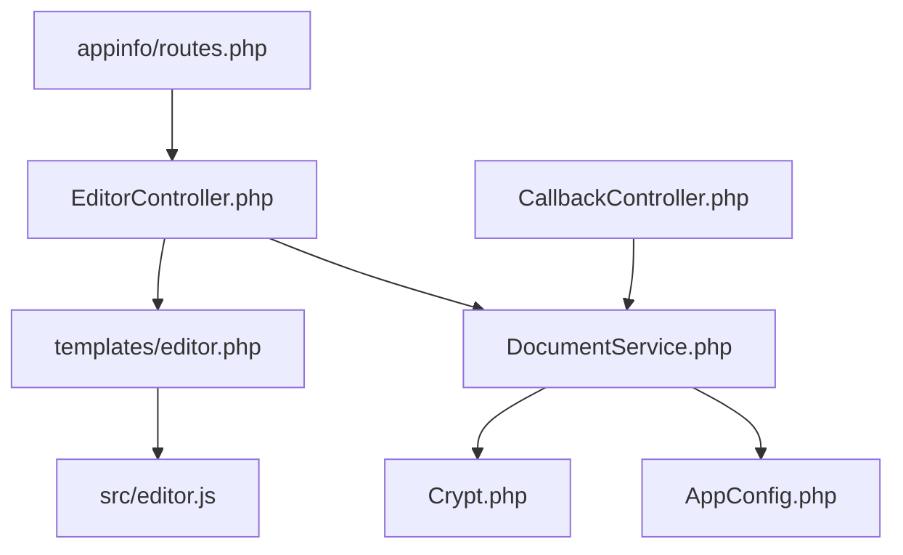

# Euro-Office/eurooffice-nextcloud

> Nextcloud app that lets you edit office documents through a Euro-Office document server.

## The problem
Nextcloud stores files but does not natively let several people edit documents, spreadsheets and presentations together.

## What it actually does
The app opens files in the Document Server editor, with real-time co-editing, PDF, watermarks and advanced permissions. The editor controller prepares the URL, the key and a callback; the server fetches the document then sends the changes back. Exchanges are signed with JWT.

## How it is wired


## Trying it
```bash
cd apps/
git clone https://github.com/Euro-Office/eurooffice-nextcloud.git eurooffice
cd eurooffice
git submodule update --init --recursive
npm install
npm run build
composer install
```

## Cost and gotchas
You need a Euro-Office Docs instance reachable from Nextcloud and from browsers, and the same JWT secret on both sides. Self-signed certificates and external storages cause known problems.

## What it is not
Not a full editor: the document server must be installed separately.

## Alternatives
No alternative named in the README.

## For you
Ignore: an office connector for Nextcloud, unrelated to data, AI or MLOps work.
