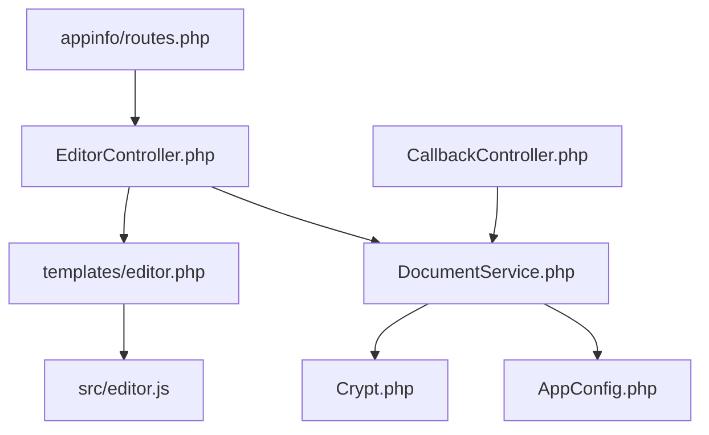

# Euro-Office/eurooffice-nextcloud

> Application Nextcloud qui permet d'éditer des documents bureautiques via un serveur de documents Euro-Office.

## Le problème
Nextcloud stocke les fichiers mais n'édite pas nativement les documents, tableurs et présentations à plusieurs.

## Ce que ça fait vraiment
L'application ouvre les fichiers dans l'éditeur du Document Server, avec co-édition en temps réel, PDF, filigranes et droits avancés. Le contrôleur d'éditeur prépare l'URL, la clé et un rappel ; le serveur récupère le document puis renvoie les modifications. Les échanges sont signés par JWT.

## Comment c'est branché


## Essayer
```bash
cd apps/
git clone https://github.com/Euro-Office/eurooffice-nextcloud.git eurooffice
cd eurooffice
git submodule update --init --recursive
npm install
npm run build
composer install
```

## Coût et pièges
Il faut une instance Euro-Office Docs joignable depuis Nextcloud et les navigateurs, et le même secret JWT des deux côtés. Certificat auto-signé et stockages externes posent des problèmes connus.

## Ce que ce n'est pas
Pas un éditeur complet : le serveur de documents est à installer à part.

## Alternatives
Aucune alternative nommée dans le README.

## Pour toi
À ignorer : un connecteur bureautique pour Nextcloud, sans lien avec un travail data, IA ou MLOps.

