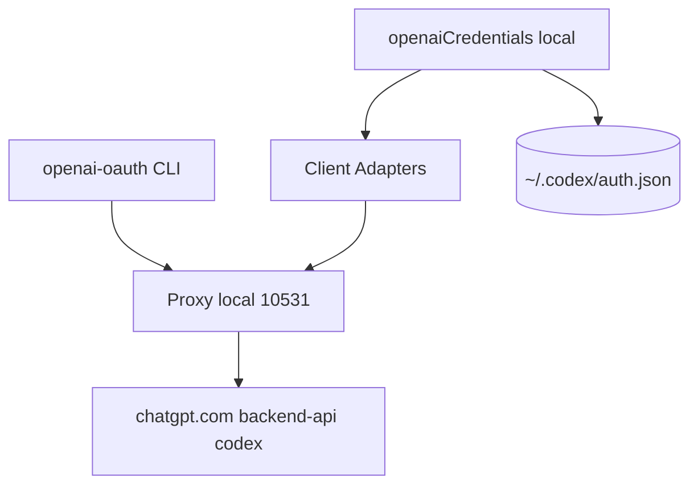

# EvanZhouDev/openai-oauth

> Proxy and SDK that expose a ChatGPT account as an OpenAI-compatible API, for developers.

## The problem
Calling OpenAI models through the API requires credits, while a ChatGPT subscription is already paid for.

## What it actually does
Reuses Codex's OAuth tokens (`~/.codex`) to target `chatgpt.com/backend-api/codex`. A local proxy on `127.0.0.1:10531/v1` imitates the OpenAI API, with image generation. Adapters cover the Vercel AI SDK and the OpenAI client. A React component adds "Sign in with ChatGPT".

## How it is wired


## Trying it
```bash
npx openai-oauth@latest
npx openai-oauth login
npx openai-oauth --detach
npx openai-oauth logs --follow
```

## Cost and gotchas
No API key, but a ChatGPT subscription and its quotas. The tokens are as sensitive as passwords. The proxy is stateless. Outside loopback (`--host`), it is exposed to the network.

## What it is not
Unofficial project, not affiliated with OpenAI. OpenAI may change or cut the underlying service. Sharing or pooling tokens is forbidden by the README. Safari not supported.

## Alternatives
No alternative named in the README other than `openai-oauth-provider`, the former package of the same project.

## For you
Keep an eye on it: handy for prototyping without credits, but fragile and risky with regard to terms of use; not for production.
