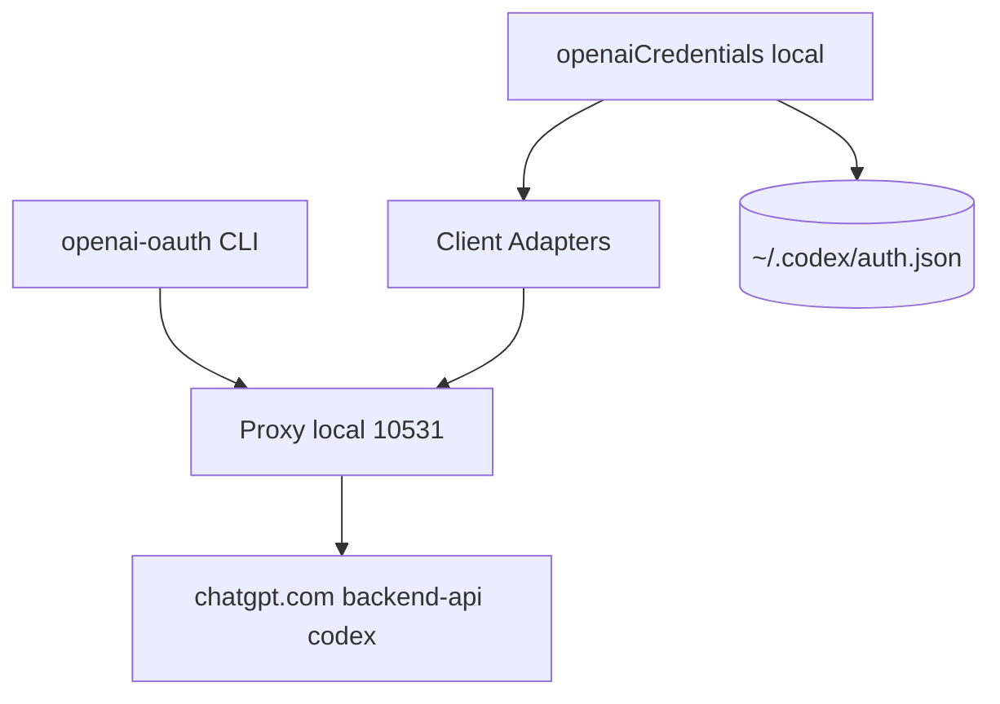

# EvanZhouDev/openai-oauth

> Proxy et SDK qui exposent un compte ChatGPT comme API compatible OpenAI, pour développeurs.

## Le problème
Appeler les modèles OpenAI par API exige des crédits, alors qu'un abonnement ChatGPT est déjà payé.

## Ce que ça fait vraiment
Réutilise les jetons OAuth de Codex (`~/.codex`) pour viser `chatgpt.com/backend-api/codex`. Un proxy local sur `127.0.0.1:10531/v1` imite l'API OpenAI, avec génération d'images. Des adaptateurs couvrent Vercel AI SDK et le client OpenAI. Un composant React ajoute « Sign in with ChatGPT ».

## Comment c'est branché


## Essayer
```bash
npx openai-oauth@latest
npx openai-oauth login
npx openai-oauth --detach
npx openai-oauth logs --follow
```

## Coût et pièges
Pas de clé d'API, mais un abonnement ChatGPT et ses quotas. Les jetons valent des mots de passe. Le proxy est sans état. Hors loopback (`--host`), il s'expose au réseau.

## Ce que ce n'est pas
Projet non officiel, non affilié à OpenAI. OpenAI peut changer ou couper le service sous-jacent. Partager ou mutualiser des jetons est interdit par le README. Safari non pris en charge.

## Alternatives
Aucune alternative nommée dans le README en dehors de `openai-oauth-provider`, ancien paquet du même projet.

## Pour toi
À surveiller : pratique pour prototyper sans crédits, mais fragile et à risque côté conditions d'usage ; pas pour de la production.

