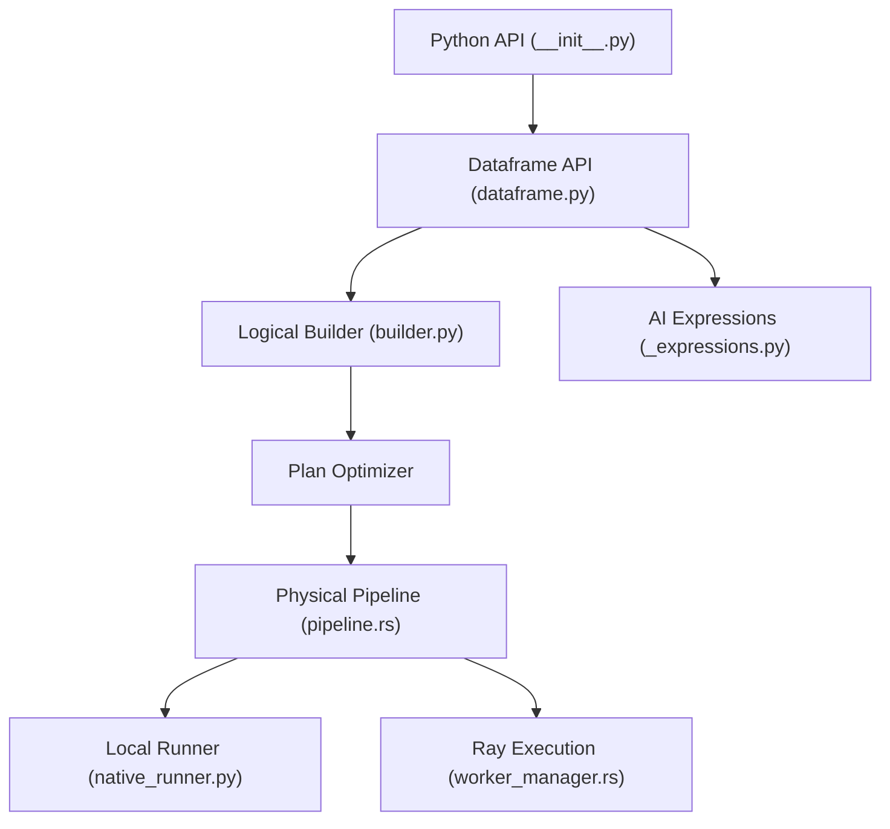

# Eventual-Inc/Daft

> Python/Rust dataframe engine for structured and multimodal data (images, audio, video), local or distributed.

## The problem
Pandas struggles with images, audio and out-of-memory volumes, and Spark requires the JVM.

## What it actually does
Daft builds a logical plan from the dataframe or SQL API, optimizes it, then executes it by micro-partitions, locally or on Ray. It reads S3, GCS, Iceberg, Delta Lake, Hugging Face and Unity Catalog, and handles images, audio and embeddings as native types. AI expressions call providers (OpenAI, Transformers, custom models) for embeddings, LLM prompts and classification. A dashboard tracks execution.

## How it is wired


## Trying it
```bash
pip install daft
```

## Cost and gotchas
Free. Python 3.10 or higher. AI calls cost according to the chosen provider. The README mentions anonymous telemetry collection via Scarf, which can be disabled with `DO_NOT_TRACK=true`.

## What it is not
Not a data warehouse or a managed service. The comparison table in the README is the vendor's own; benchmarks must be reproduced by you.

## Alternatives
- Polars: optimizer and vectorized execution, but not distributed.
- Ray Data: distributed and multimodal, without a query optimizer.
- PySpark: distributed, but no native multimodal support.

## For you
Adopt for multimodal data pipelines (image preparation, embeddings) that need to move from your workstation to a Ray cluster without rewriting; active repository (push of 2026-11-04).
