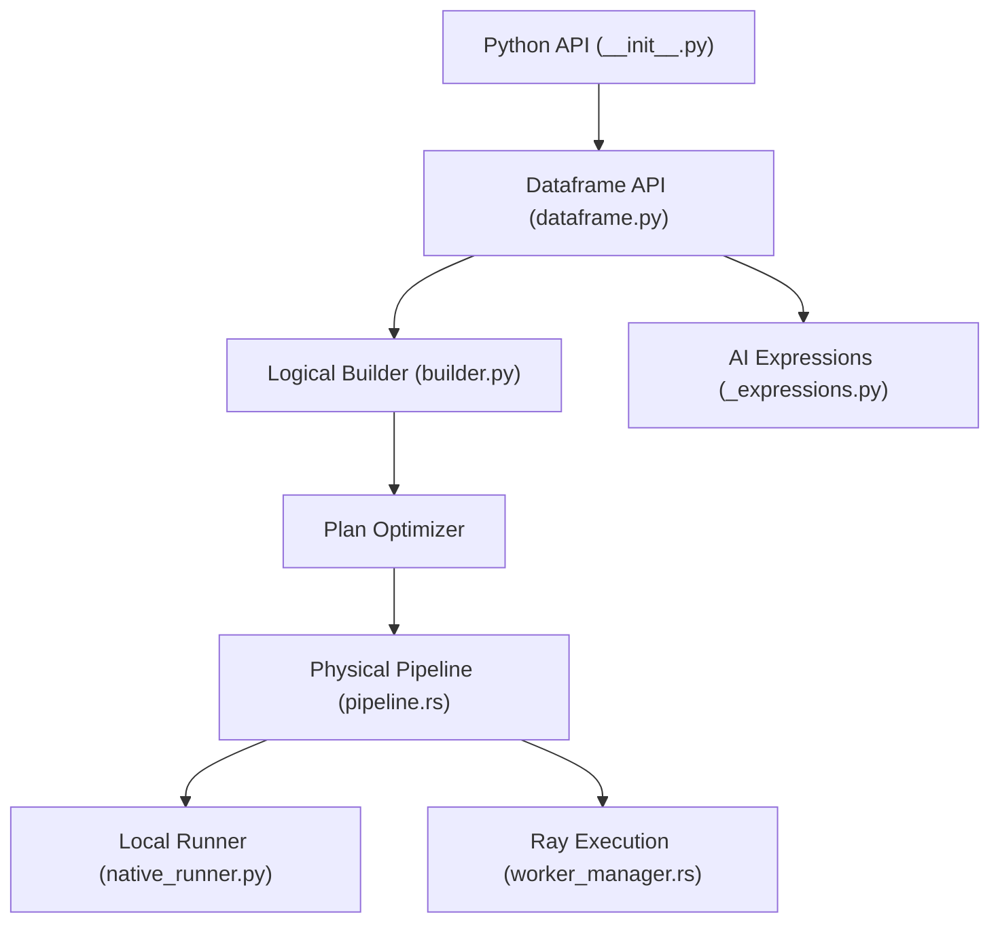

# Eventual-Inc/Daft

> Moteur de dataframes Python/Rust pour données structurées et multimodales (images, audio, vidéo) en local ou distribué.

## Le problème
Pandas peine sur des images, de l'audio et des volumes hors mémoire, et Spark impose la JVM.

## Ce que ça fait vraiment
Daft construit un plan logique à partir de l'API dataframe ou SQL, l'optimise, puis l'exécute par micro-partitions, en local ou sur Ray. Il lit S3, GCS, Iceberg, Delta Lake, Hugging Face et Unity Catalog, et gère images, audio et embeddings comme types natifs. Des expressions IA appellent des fournisseurs (OpenAI, Transformers, modèles perso) pour embeddings, prompts LLM et classification. Un tableau de bord suit l'exécution.

## Comment c'est branché


## Essayer
```bash
pip install daft
```

## Coût et pièges
Gratuit. Python 3.10 ou plus. Les appels IA coûtent selon le fournisseur choisi. Le README signale une collecte de télémétrie anonyme via Scarf, désactivable avec `DO_NOT_TRACK=true`.

## Ce que ce n'est pas
Pas un entrepôt de données ni un service géré. Le tableau comparatif du README est celui de l'éditeur ; les benchmarks sont à reproduire toi-même.

## Alternatives
- Polars : optimiseur et exécution vectorisée, mais pas distribué.
- Ray Data : distribué et multimodal, sans optimiseur de requêtes.
- PySpark : distribué, mais pas de multimodal natif.

## Pour toi
À adopter pour des pipelines de données multimodales (préparation d'images, embeddings) qui doivent passer de ton poste à un cluster Ray sans réécriture ; dépôt actif (push du 2026-11-04).

