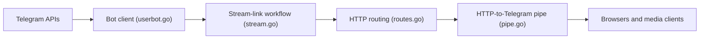

# EverythingSuckz/TG-FileStreamBot

> Telegram bot that generates direct download links for sent files, for those who host their own links.

## The problem
Files stored on Telegram have no direct HTTP URL usable by a browser or a media player.

## What it actually does
Very short README (under 800 characters, no instructions). Based on the code: a Go service combining a Telegram bot, a Telegram user session and an HTTP server; a received message produces a link with a hashed identifier, and the server relays the bytes from Telegram. Configuration through environment variables, cache, QR login. Docker and Procfile provided.

## How it is wired

## Trying it
No command documented in the README; it points to an external documentation site.

## Cost and gotchas
Free, but you need a Telegram bot, Telegram API credentials and hosting. Usage is subject to Telegram's terms, to be checked.

## What it is not
Not a storage service: Telegram remains the source. AGPL-3.0 license: any fork exposed over a network must stay open.

## Alternatives
Teldrive is cited in the credits (a neighboring project), without comparison.

## For you
Ignore: a link-workaround tool unrelated to data or AI, README insufficient to evaluate.
