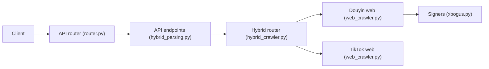

# Evil0ctal/Douyin_TikTok_Download_API

> Self-hosted data collection and download API for Douyin and TikTok.

## The problem
Douyin and TikTok offer no simple access to their data: anti-bot signatures, expiring cookies, endpoints that change without notice.

## What it actually does
v5 retrieves posts, authors, comments, searches, and downloads videos without watermark (clean stream already published).
A headless browser generates guest identities; a scheduler rotates them with token buckets and per-endpoint circuit breakers.
a_bogus, X-Bogus, X-Gnarly, X-Dynosaur signatures in Python; PostgreSQL/TimescaleDB + Redis archiving.
Access through REST (93 operations), MCP, the `dtk` CLI and a React console.

## How it is wired

Warning: this diagram follows the supplied architecture, which describes v4; the v5 in the README is a rewrite.

## Trying it
```bash
git clone https://github.com/Evil0ctal/Douyin_TikTok_Download_API.git
cd Douyin_TikTok_Download_API
docker compose -p dtk -f docker/compose.yml up -d
docker compose -p dtk -f docker/compose.yml logs api
```

## Cost and gotchas
Free, but you need Postgres with TimescaleDB, Redis and a browser container. The browser image is not published: a local build is mandatory.

## What it is not
Not an official API: everything relies on reverse engineering and can break with every platform change. Compliance with the terms of service and the law is your responsibility.

## Alternatives
No named alternative; v4 remains available on a branch.

## For you
Ignore unless you have a specific need for TikTok data: the legal risk and the fragility against platform changes outweigh the gain for a generalist data profile.
