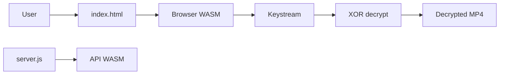

# Evil0ctal/WeChat-Channels-Video-File-Decryption

> Decryption tool for WeChat Channels videos, in browser, CLI, graphical interface or REST API.

## The problem
WeChat Channels videos are encrypted on their first 128 KB and unplayable once downloaded.

## What it actually does
From the `decode_key` of an API response, WeChat's WASM module generates a 131,072-byte Isaac64 keystream, reversed then XORed onto the start of the MP4 file. Four uses: local web page, Python CLI, tkinter GUI, Express/Docker service. The README states that the key and the file must come from the same response.

## How it is wired


## Trying it
```bash
python3 -m http.server 8888
python3 decrypt_wechat_video_cli.py -i wx_encrypted.mp4 -k keystream_131072_bytes.txt -o wx_decrypted.mp4
docker pull evil0ctal/wechat-decrypt-api:latest
```

## Cost and gotchas
Free. The API service bundles WASM files extracted from the WeChat client (3.8 MB) and may fall back to WeChat's CDN.

## What it is not
Not an acquisition tool: you must already have captured the `decode_key`. Reverse engineering of a third-party product, "for study purposes" according to the README, subject to the platform's terms.

## Alternatives
No alternative named in the README.

## For you
Ignore: circumvention of a third-party service's protection, legal risk and no data/AI/MLOps use.
