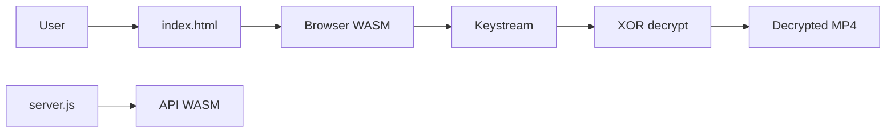

# Evil0ctal/WeChat-Channels-Video-File-Decryption

> Outil de déchiffrement des vidéos WeChat Channels, en navigateur, CLI, interface graphique ou API REST.

## Le problème
Les vidéos de WeChat Channels sont chiffrées sur leurs 128 premiers Ko et illisibles une fois téléchargées.

## Ce que ça fait vraiment
À partir du `decode_key` d'une réponse d'API, le module WASM de WeChat génère un flux de clés Isaac64 de 131 072 octets, inversé puis appliqué en XOR au début du fichier MP4. Quatre usages : page web locale, CLI Python, GUI tkinter, service Express/Docker. Le README indique que la clé et le fichier doivent venir de la même réponse.

## Comment c'est branché


## Essayer
```bash
python3 -m http.server 8888
python3 decrypt_wechat_video_cli.py -i wx_encrypted.mp4 -k keystream_131072_bytes.txt -o wx_decrypted.mp4
docker pull evil0ctal/wechat-decrypt-api:latest
```

## Coût et pièges
Gratuit. Le service API embarque des fichiers WASM extraits du client WeChat (3,8 Mo) et peut retomber sur le CDN de WeChat.

## Ce que ce n'est pas
Pas un outil d'acquisition : il faut déjà capturer le `decode_key`. Reverse engineering d'un produit tiers, usage « à des fins d'étude » selon le README, soumis aux conditions de la plateforme.

## Alternatives
Aucune alternative nommée dans le README.

## Pour toi
Ignorer : contournement de protection d'un service tiers, risque juridique et aucun usage data/IA/MLOps.

