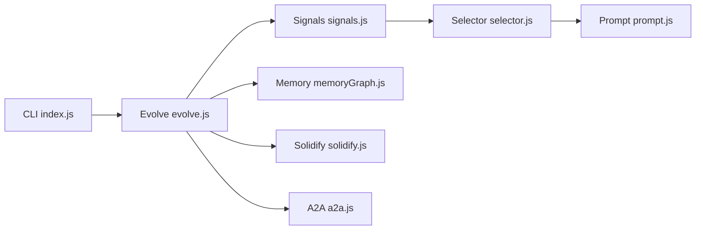

# EvoMap/evolver

> Node.js CLI that turns an agent's logs into auditable evolution prompts (GEP protocol).

## The problem
Improving an agent is done through one-off prompt tweaks, with no trace and no reuse of fixes.

## What it actually does
In a git repository, `evolver` reads `./memory/` (logs, errors, signals), picks a "Gene" or "Capsule" from a local store, emits a GEP prompt on stdout and records an `EvolutionEvent`. It does not edit code: only `solidify.js` runs filtered validation commands (`node`, `npm`, `npx`). Hooks for Cursor, Claude Code, Codex, Kiro, opencode; optional EvoMap hub (skills, worker pool, validation).

## How it is wired


## Trying it
```bash
npm install -g @evomap/evolver
evolver
evolver --review
evolver --loop
evolver setup-hooks --platform=claude-code
```

## Cost and gotchas
Free offline. With the hub, the validator role is active by default and automatic GitHub issue reporting is enabled if a token is present.

## What it is not
Not an autonomous code patcher: it produces text that a host runtime (OpenClaw) interprets. The project announces a move to a "source-available" model.

## Alternatives
No alternative named; Hermes Agent is cited only for a similarity accusation.

## For you
Worth watching: the idea of capitalizing agent fixes as auditable "genes" is interesting, but the announced move to source-available, the GPL and the network features active by default hinder adoption.
