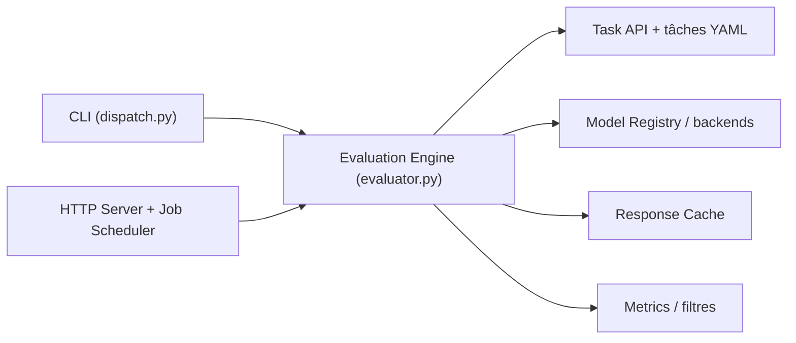

# EvolvingLMMs-Lab/lmms-eval

> Unified evaluation toolkit for multimodal models (image, video, audio) across more than 100 tasks.

## The problem
Multimodal evaluations are scattered: datasets, post-processing and single-number scores that hide the noise.

## What it actually does
A CLI (`python -m lmms_eval`) loads a model (30+ families, or any OpenAI-compatible endpoint, vLLM, SGLang) and tasks defined in YAML, runs inference, applies filters and metrics, and logs the results. It adds a response cache, confidence intervals and paired tests, an HTTP evaluation server with a job queue, a web interface and an MCP server.

## How it is wired


## Trying it
```bash
git clone https://github.com/EvolvingLMMs-Lab/lmms-eval.git
cd lmms-eval && uv pip install -e ".[all]"
python -m lmms_eval \
  --model qwen2_5_vl \
  --model_args pretrained=Qwen/Qwen2.5-VL-3B-Instruct \
  --tasks mme \
  --batch_size 1 \
  --limit 8
```

## Cost and gotchas
GPU for local models, API keys for hosted models. The HTTP server is intended for trusted environments only, with no authentication. The license is to be verified.

## What it is not
Not a test bench for text-only models. The audio and video wiring was not re-read in the code by the diagram.

## Alternatives
No alternative named in the README.

## For you
Adopt it if you evaluate multimodal models: reproducible pipeline with statistics, and `--limit 8` lets you test before any big computation.
