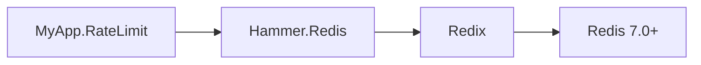

# ExHammer/hammer-backend-redis

> Redis backend for the Hammer rate limiter, for Elixir applications that share their counters.

## The problem
An in-memory rate limiter does not share its counters across several nodes; Redis centralizes the state.

## What it actually does
Thin layer around Redix, with one connection per limiter. Fixed-window algorithm, plus `:token_bucket` and `:leaky_bucket` for `hit_many/1`, which checks several limits in a single atomic round trip and counts nothing when denied. Redis 7.0 or later is required, otherwise counters never expire.

## How it is wired


## Trying it
```elixir
{:hammer_backend_redis, "~> 7.0"}

defmodule MyApp.RateLimit do
  use Hammer, backend: Hammer.Redis
end

children = [{MyApp.RateLimit, url: "redis://localhost:6379"}]
```
```bash
docker compose up -d redis
```

## Cost and gotchas
A Redis 7.0+ is needed; on an older version, memory grows without bound. In a cluster, all keys of a `hit_many/1` must share a hash tag. Elixir required, not in the list.

## What it is not
It is not a standalone limiter: the Hammer library is required. A single connection is used, without a pool, which is intentional.

## Alternatives
No alternative named in the README.

## For you
Ignore: reserved for the Elixir ecosystem, with no direct link to a data, AI or MLOps profile.
