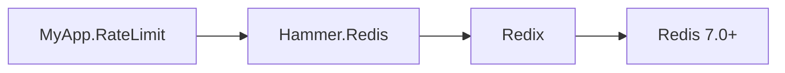

# ExHammer/hammer-backend-redis

> Backend Redis du limiteur de débit Hammer, pour applications Elixir qui partagent leurs compteurs.

## Le problème
Un limiteur de débit en mémoire ne partage pas ses compteurs entre plusieurs nœuds ; Redis centralise l'état.

## Ce que ça fait vraiment
Fine couche autour de Redix, avec une connexion par limiteur. Algorithme de fenêtre fixe, ainsi que `:token_bucket` et `:leaky_bucket` pour `hit_many/1`, qui vérifie plusieurs limites en un seul aller-retour atomique et ne compte rien en cas de refus. Redis 7.0 ou plus est requis, sinon les compteurs n'expirent jamais.

## Comment c'est branché


## Essayer
```elixir
{:hammer_backend_redis, "~> 7.0"}

defmodule MyApp.RateLimit do
  use Hammer, backend: Hammer.Redis
end

children = [{MyApp.RateLimit, url: "redis://localhost:6379"}]
```
```bash
docker compose up -d redis
```

## Coût et pièges
Il faut un Redis 7.0+ ; sur une version plus ancienne, la mémoire croît sans limite. En cluster, toutes les clés d'un `hit_many/1` doivent partager un hash tag. Elixir requis, hors liste.

## Ce que ce n'est pas
Ce n'est pas un limiteur autonome : il faut la bibliothèque Hammer. Une seule connexion est utilisée, sans pool, ce qui est voulu.

## Alternatives
Aucune alternative nommée dans le README.

## Pour toi
À ignorer : réservé à l'écosystème Elixir, sans lien direct avec un profil data, IA ou MLOps.

