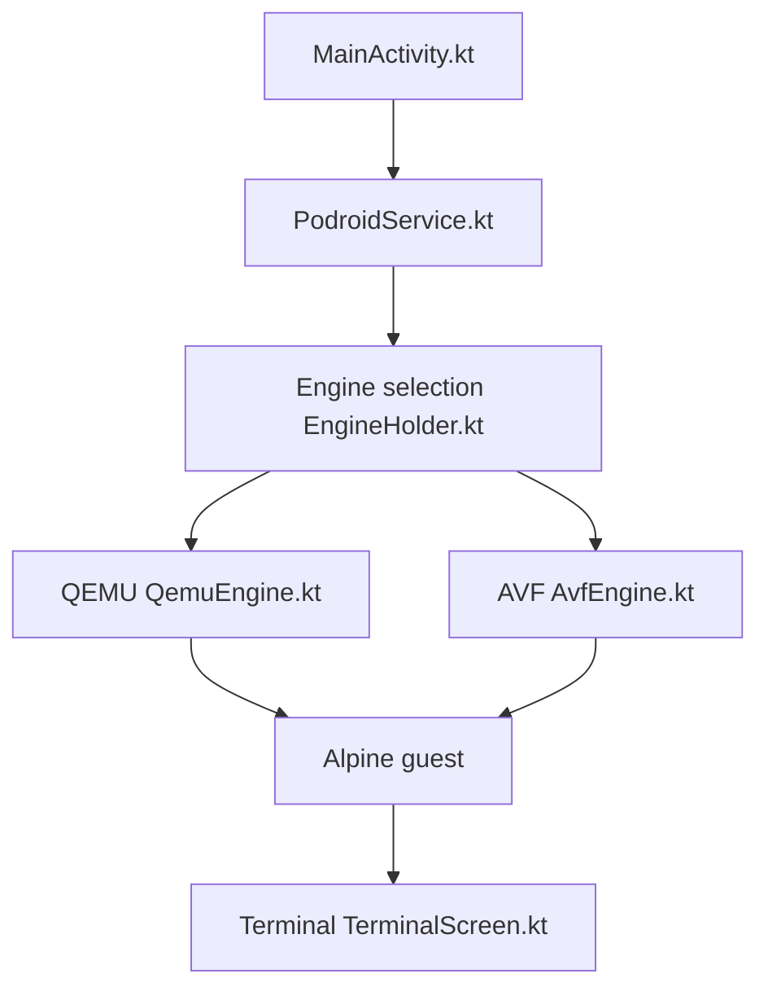

# ExTV/Podroid

> Android app that runs a real Alpine virtual machine with Podman, Docker and an X11 desktop, without root.

## The problem
Chroot-style environments on a phone do not behave like a server: containers and kernel are limited.

## What it actually does
An Alpine VM with its own kernel, via QEMU or, on pKVM-compatible devices, via the Android Virtualization Framework. Podman, Docker and LXC come preinstalled; built-in terminal, X11 viewer, USB, SSH, port forwarding, guest-Android bridge, container backup. Works on any arm64 Android 8+ device.

## How it is wired


## Trying it
```sh
podman run --rm alpine echo "hello from a container"
podroid-forward add 8080 8080 tcp
ssh root@<phone-ip> -p 9922
```
Default SSH password given: `podroid`.

## Cost and gotchas
Free. QEMU emulation is slow without hardware acceleration. Change the default SSH password; exposing it on the LAN is a risk. GPL-2.0 license (copyleft).

## What it is not
Not a native Docker on Android. Not performance equivalent to a real server when running on QEMU.

## Alternatives
- Termux: terminal engine reused by Podroid, cited in the credits.

## For you
Worth watching for testing containers on a phone; of no interest for a real MLOps pipeline.
