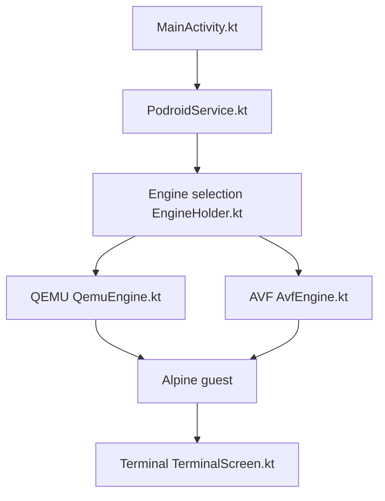

# ExTV/Podroid

> Application Android qui lance une vraie machine virtuelle Alpine avec Podman, Docker et bureau X11, sans root.

## Le problème
Les environnements de type chroot sur téléphone ne se comportent pas comme un serveur : conteneurs et noyau limités.

## Ce que ça fait vraiment
Une VM Alpine avec son propre noyau, via QEMU ou, sur appareils compatibles pKVM, via Android Virtualization Framework. Podman, Docker et LXC préinstallés ; terminal intégré, visionneuse X11, USB, SSH, redirection de ports, passerelle invité-Android, sauvegarde de conteneurs. Fonctionne sur tout appareil arm64 Android 8+.

## Comment c'est branché


## Essayer
```sh
podman run --rm alpine echo "hello from a container"
podroid-forward add 8080 8080 tcp
ssh root@<phone-ip> -p 9922
```
Mot de passe SSH par défaut indiqué : `podroid`.

## Coût et pièges
Gratuit. Émulation QEMU lente sans accélération matérielle. Change le mot de passe SSH par défaut ; l'exposer sur le LAN est un risque. Licence GPL-2.0 (copyleft).

## Ce que ce n'est pas
Pas un Docker natif Android. Pas de performance équivalente à un serveur réel sur QEMU.

## Alternatives
- Termux : moteur de terminal repris par Podroid, cité dans les crédits.

## Pour toi
À surveiller pour tester des conteneurs sur téléphone ; sans intérêt pour un pipeline MLOps réel.

