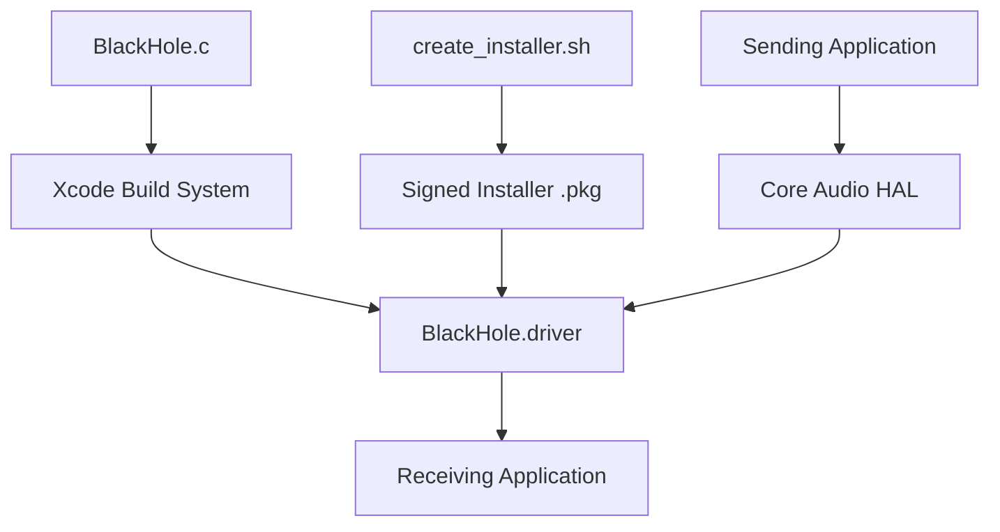

# ExistentialAudio/BlackHole

> Virtual macOS audio driver that passes sound from one application to another with no added latency.

## The problem
On macOS, sending audio from one application to another (recording system sound, routing a DAW to Zoom) is not natively possible.

## What it actually does
It is a Core Audio HAL plugin (`BlackHole.driver`, installed in `/Library/Audio/Plug-Ins/HAL`) that exposes a virtual device. One application writes to it, another reads it as input. Versions from 2 to 256 channels, sample rates from 8 kHz to 768 kHz, no kernel extension. Channels, latency and mirror device are set at compile time through constants.

## How it is wired


## Trying it
```bash
brew install blackhole-2ch
brew install blackhole-16ch
brew install blackhole-64ch
sudo killall -9 coreaudiod
```

## Cost and gotchas
Free, macOS only. Installation followed by a restart is required. The README says GPL-3.0: use in an application only if it is also GPL-3.0, otherwise contact the publisher. GitHub does not identify the license.

## What it is not
It is not an application: nothing in the Applications folder, it appears in Audio MIDI Setup. No Windows or Linux. Multi-output devices are buggy with some apps (Apple Podcasts, Messages).

## Alternatives
- BackgroundMusic: automatic pause, per-application volume, system sound recording.
- MultiSoundChanger: volume of aggregate devices.

## For you
Ignore unless you work on macOS: useful for capturing system audio for transcription, but the license is unclear and it has no interest outside that platform.
