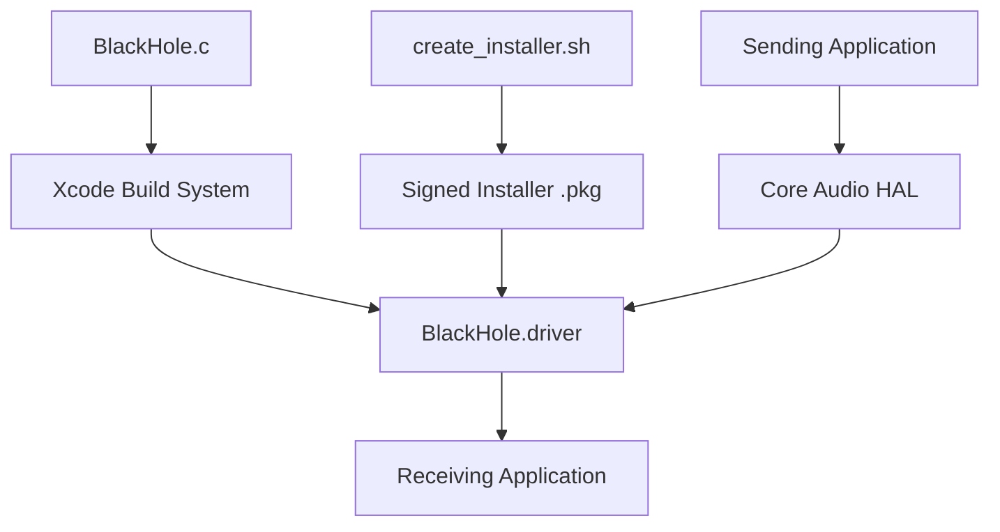

# ExistentialAudio/BlackHole

> Pilote audio virtuel macOS qui fait passer le son d'une application à une autre sans latence ajoutée.

## Le problème
Sur macOS, envoyer l'audio d'une application vers une autre (enregistrer le son système, router un DAW vers Zoom) n'est pas possible nativement.

## Ce que ça fait vraiment
C'est un plugin Core Audio HAL (`BlackHole.driver`, installé dans `/Library/Audio/Plug-Ins/HAL`) qui expose un périphérique virtuel. Une application écrit dessus, une autre le lit en entrée. Versions de 2 à 256 canaux, fréquences de 8 kHz à 768 kHz, sans extension noyau. Canaux, latence et périphérique miroir se règlent à la compilation par constantes.

## Comment c'est branché


## Essayer
```bash
brew install blackhole-2ch
brew install blackhole-16ch
brew install blackhole-64ch
sudo killall -9 coreaudiod
```

## Coût et pièges
Gratuit, macOS uniquement. Installation puis redémarrage demandés. Le README dit GPL-3.0 : usage dans une appli seulement si elle est aussi GPL-3.0, sinon contacter l'éditeur. GitHub n'identifie pas la licence.

## Ce que ce n'est pas
Ce n'est pas une application : rien dans le dossier Applications, il apparaît dans Audio MIDI Setup. Pas de Windows ni de Linux. Les périphériques multi-sorties sont bogués avec certaines apps (Apple Podcasts, Messages).

## Alternatives
- BackgroundMusic : pause automatique, volume par application, enregistrement du son système.
- MultiSoundChanger : volume des périphériques agrégés.

## Pour toi
Ignorer sauf si tu travailles sous macOS : utile pour capter l'audio système vers de la transcription, mais licence floue et aucun intérêt hors de cette plateforme.

