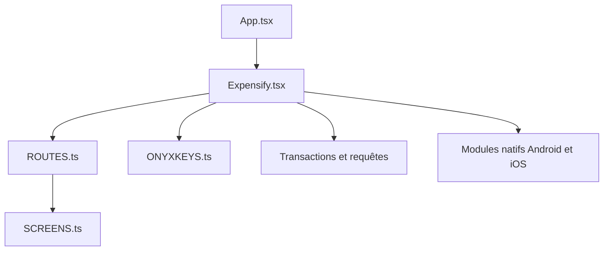

# Expensify/App

> Cross-platform chat and expense-reporting application (New Expensify), repository intended for contributors.

## The problem
Managing expense reports and payments in a tool separate from team conversations is cumbersome.

## What it actually does
The repository is the React Native client of New Expensify: payments built on top of messaging, with routing, shared state (Onyx), HTML rendering of messages, onboarding and Android, iOS and hybrid integrations. The README only covers local development, environment variables and tests (Jest, Bun, Reassure).

## How it is wired


## Trying it
```bash
npm install
npm run web
npm run test
```

## Cost and gotchas
Free to contribute (MIT), but the backend is an Expensify service: an external contributor must set `USE_WEB_PROXY=true`. Strict Node and npm versions (`.nvmrc`), watchman, local HTTPS.

## What it is not
Not a standalone product: it needs Expensify's servers. Not a reusable library.

## Alternatives
No alternative cited in the README.

## For you
Ignore: client of a financial SaaS, hardly transferable to a data, AI or MLOps project.
