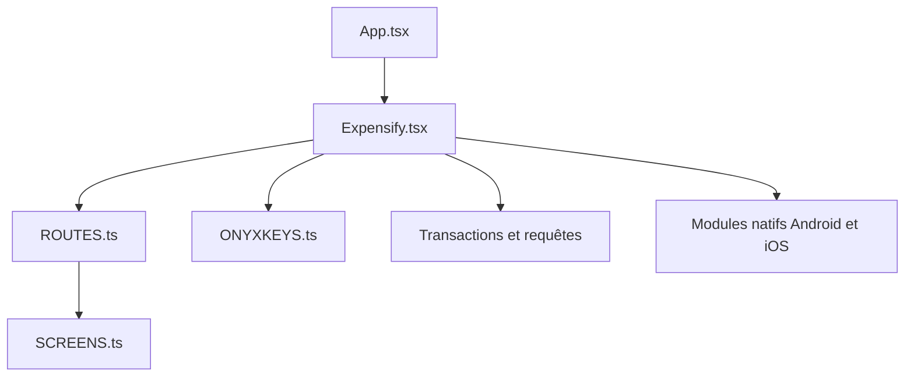

# Expensify/App

> Application multiplateforme de discussion et de notes de frais (New Expensify), dépôt destiné aux contributeurs.

## Le problème
Gérer notes de frais et paiements dans un outil séparé des conversations d'équipe est lourd.

## Ce que ça fait vraiment
Le dépôt est le client React Native de New Expensify : paiements construits sur une messagerie, avec routage, état partagé (Onyx), rendu HTML des messages, onboarding et intégrations Android, iOS et hybrides. Le README ne parle que du développement local, des variables d'environnement et des tests (Jest, Bun, Reassure).

## Comment c'est branché


## Essayer
```bash
npm install
npm run web
npm run test
```

## Coût et pièges
Gratuit pour contribuer (MIT), mais le backend est un service Expensify : un contributeur externe doit mettre `USE_WEB_PROXY=true`. Node et npm en version stricte (`.nvmrc`), watchman, HTTPS local.

## Ce que ce n'est pas
Pas un produit autonome : il faut les serveurs d'Expensify. Pas une bibliothèque réutilisable.

## Alternatives
Aucune alternative citée dans le README.

## Pour toi
À ignorer : client d'un SaaS financier, peu transposable à un projet data, IA ou MLOps.

