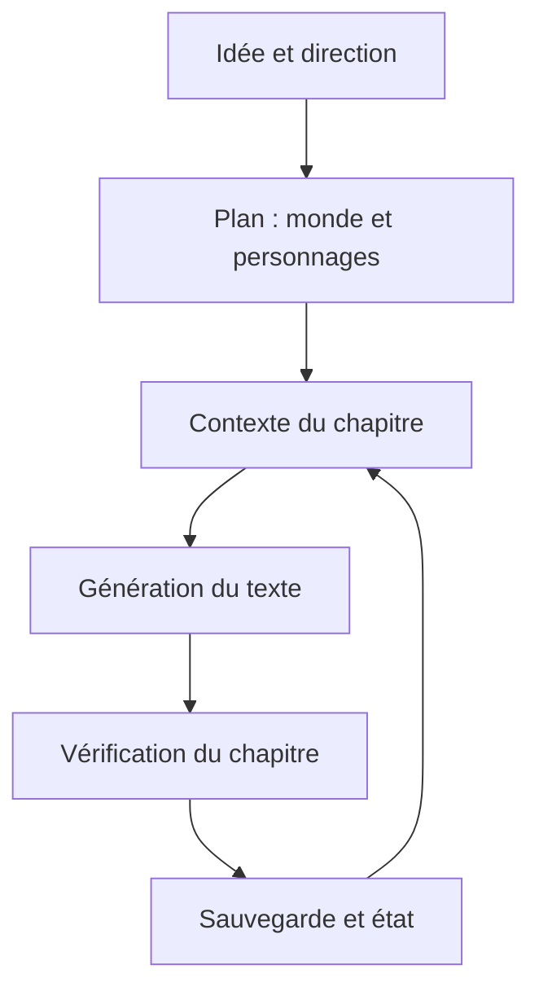

# ExplosiveCoderflome/AI-Novel-Writing-Assistant

> AI-assisted novel writing workshop, in Chinese, with an automatic "director" for long narratives.

## The problem
Writing a long novel requires keeping characters, world and chapters consistent, and knowing what the AI consumes.

## What it actually does
From an idea, it proposes directions, an outline, characters and a world, then generates and checks the chapters. Two director modes: V1 step by step, V2 over an authorized range. It includes a short flow, a knowledge base (RAG, Qdrant), model routing and token tracking.

## How it is wired


## Trying it
```bash
git clone https://github.com/ExplosiveCoderflome/AI-Novel-Writing-Assistant.git
cd AI-Novel-Writing-Assistant
pnpm install
cp server/.env.example server/.env
pnpm dev
```

## Cost and gotchas
API key from your model provider, billed by usage; default limit of 100,000 tokens per chapter in V2. The desktop app ships for Windows. Node 20.19+ and pnpm 10.6+ for the source.

## What it is not
Not an autonomous writer: automatic mode stops at the end of the authorized range. Documentation and interface are in Chinese.

## Alternatives
No alternative named in the README (the Ani Book Skill for Codex is a complement).

## For you
Worth watching: an interesting LLM orchestration pattern (resume, quotas, prefix cache), but the interface is Chinese and the license needs checking.
