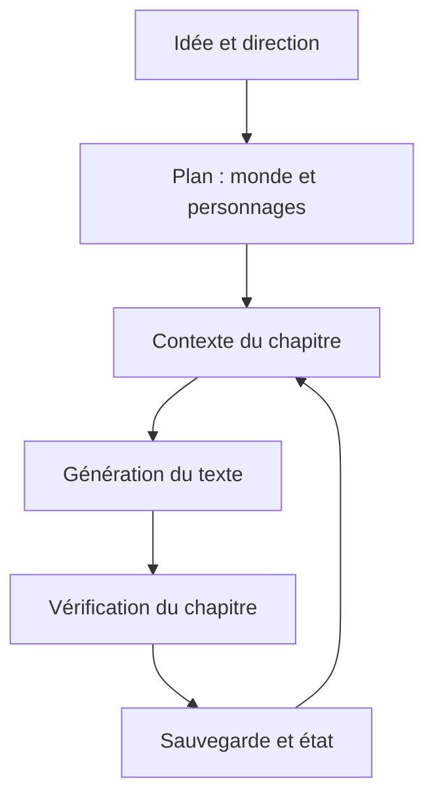

# ExplosiveCoderflome/AI-Novel-Writing-Assistant

> Atelier d'écriture de romans assisté par IA, en chinois, avec un « directeur » automatique pour les longs récits.

## Le problème
Écrire un roman long exige de garder cohérents personnages, monde et chapitres, et de savoir ce que l'IA consomme.

## Ce que ça fait vraiment
À partir d'une idée, il propose des directions, un plan, des personnages et un monde, puis génère et vérifie les chapitres. Deux modes de directeur : V1 par étapes, V2 sur une plage autorisée. Il comprend un flux court, une base de connaissances (RAG, Qdrant), un routage de modèles et un suivi des tokens.

## Comment c'est branché


## Essayer
```bash
git clone https://github.com/ExplosiveCoderflome/AI-Novel-Writing-Assistant.git
cd AI-Novel-Writing-Assistant
pnpm install
cp server/.env.example server/.env
pnpm dev
```

## Coût et pièges
Clé d'API de votre fournisseur de modèles, facturée selon l'usage ; limite par défaut de 100 000 tokens par chapitre en V2. Le bureau est livré pour Windows. Node 20.19+ et pnpm 10.6+ pour la source.

## Ce que ce n'est pas
Pas un écrivain autonome : le mode automatique s'arrête à la fin de la plage autorisée. Documentation et interface en chinois.

## Alternatives
Aucune alternative nommée dans le README (le Ani Book Skill pour Codex est un complément).

## Pour toi
À surveiller : patron intéressant d'orchestration LLM (reprise, quotas, cache de préfixe), mais interface chinoise et licence à vérifier.

