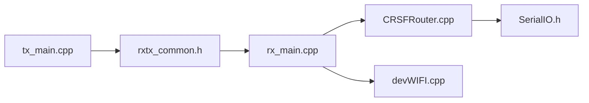

# ExpressLRS/ExpressLRS

> Low-latency LoRa radio link firmware for FPV and radio control.

## The problem
Hobby radio links are limited in range or latency.

## What it actually does
Transmitter and receiver firmware on SX127x/SX1280 chips with ESP or STM32. 900 MHz (200 Hz max) and 2.4 GHz (1000 Hz) links. Telemetry, WiFi updates, CRSF, SBUS, MAVLink and PWM protocols, VTX tuning, binding phrases.

## How it is wired

## Trying it
No command: the README points to the Configurator (separate repository) and the website.

## Cost and gotchas
Free on the software side; hardware must be purchased. Published by ExpressLRS LLC.

## What it is not
Not configuration software: that is the Configurator, a separate repository.

## Alternatives
No alternative cited in the README.

## For you
Ignore: radio control firmware, unrelated to data / AI / MLOps.
