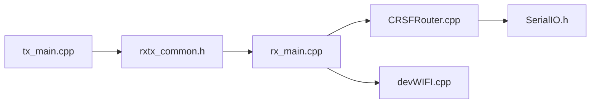

# ExpressLRS/ExpressLRS

> Firmware de liaison radio LoRa faible latence pour FPV et radiocommande.

## Le problème
Les liens radio de modélisme sont limités en portée ou en latence.

## Ce que ça fait vraiment
Firmware émetteur et récepteur sur puces SX127x/SX1280 avec ESP ou STM32. Liaisons 900 MHz (200 Hz max) et 2,4 GHz (1000 Hz). Télémétrie, mises à jour WiFi, protocoles CRSF, SBUS, MAVLink, PWM, réglage VTX, phrases de liaison.

## Comment c'est branché

## Essayer
Aucune commande : le README renvoie au Configurator (dépôt séparé) et au site.

## Coût et pièges
Gratuit côté logiciel ; le matériel est à acheter. Édité par ExpressLRS LLC.

## Ce que ce n'est pas
Pas un logiciel de configuration : c'est le Configurator, dépôt à part.

## Alternatives
Aucune alternative citée dans le README.

## Pour toi
À ignorer : firmware de radiocommande, sans rapport avec data / IA / MLOps.

