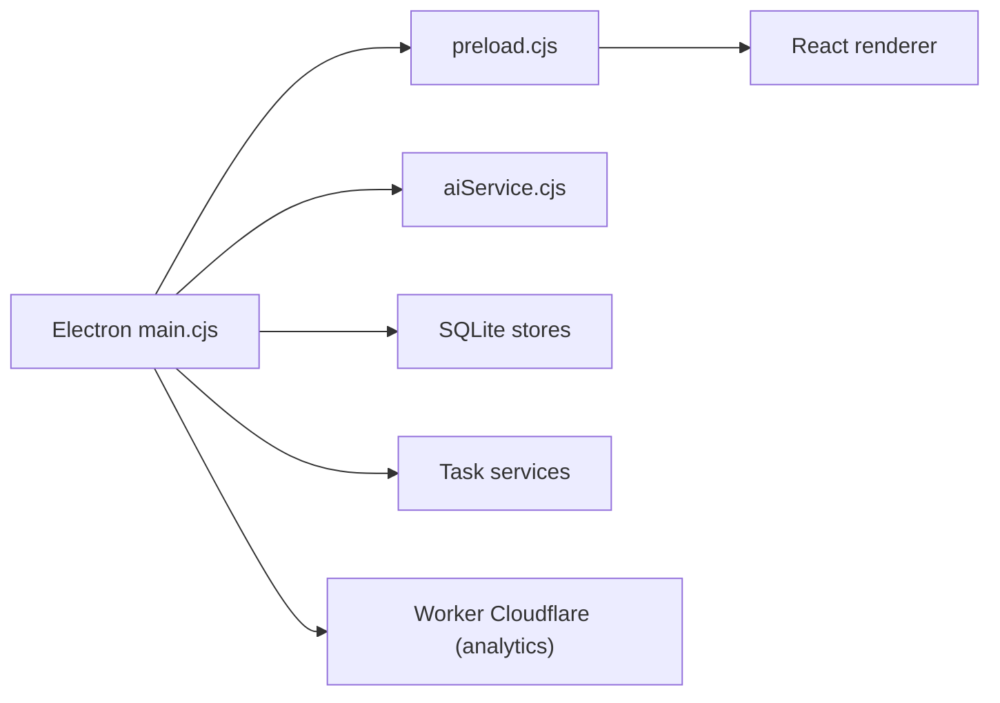

# FB208/OpenBidKit_Yibiao

> Desktop application (README in Chinese) that helps write tender bid documents with an LLM.

## The problem
Paid tools for writing tender responses are expensive for small Chinese companies.

## What it actually does
Electron client (React, local SQLite): analysis of the tender file, outline, writing of the technical plan, company knowledge base, duplicate check, detection of rejection grounds, Word export. Accepts any OpenAI-compatible API, Ollama or LM Studio. The author cites 11,000 words for 2.19 M tokens (1.03 ¥). A Cloudflare Worker service provides announcements, resources, licenses and statistics.

## How it is wired


## Trying it
```powershell
cd client
npm ci
npm run dev
npm run dist:win
```

## Cost and gotchas
LLM provider key at your expense; Node.js 22 and .NET 10 to build. The README contains sponsor ads and usage figures. The AGPL-3.0 requires modified versions to be opened up, even as a network service. The online service collects usage statistics.

## What it is not
Not an international tool: targeted at Windows and the Chinese market, with an archive of the old web version (FastAPI) kept.

## Alternatives
Not documented in the README.

## For you
Ignore: domain (Chinese tenders), language and AGPL license are outside your context.
