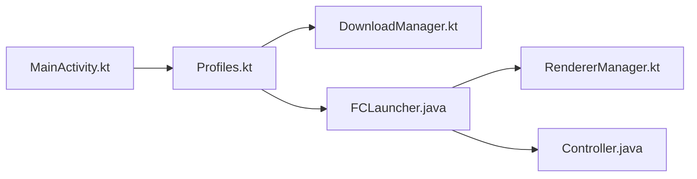

# FCL-Team/FoldCraftLauncher

> Android launcher for Minecraft Java Edition, based on HMCL, for mobile players.

## The problem
Playing Minecraft Java on Android requires a suitable Java runtime and renderer.

## What it actually does
Manages profiles and versions, downloads, modloaders (Forge, NeoForge, Fabric, Quilt, OptiFine…), built-in Java 8/17/21/25, virtual mouse, custom keys, ZalithLauncher2 layout conversion, pluggable renderers, multiplayer via Terracotta/EasyTier. Microsoft and Yggdrasil authentication.

## How it is wired

## Trying it
No commands: the README describes features and dependencies, with no installation procedure.

## Cost and gotchas
Free. Dependencies under various licenses (including AGPL, LGPL; LWJGLX with unknown license). README in Chinese, English and Russian.

## What it is not
Not a PC launcher: it is a Minecraft Java launcher for Android, unrelated to data or AI.

## Alternatives
- HMCL: source of the functional core.

## For you
Ignore: mobile game launcher, outside the data / AI / MLOps profile.
