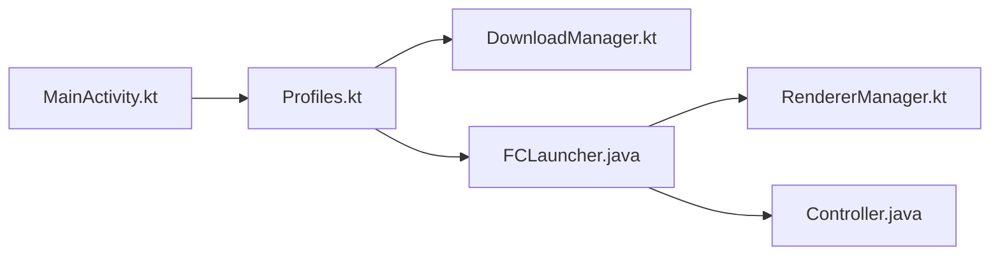

# FCL-Team/FoldCraftLauncher

> Lanceur Android de Minecraft Java Edition, fondé sur HMCL, pour joueurs mobiles.

## Le problème
Jouer à Minecraft Java sur Android demande un runtime Java et un rendu adaptés.

## Ce que ça fait vraiment
Gère profils et versions, téléchargements, modloaders (Forge, NeoForge, Fabric, Quilt, OptiFine…), Java 8/17/21/25 intégrés, souris virtuelle, clés personnalisées, conversion de dispositions ZalithLauncher2, rendus pluggables, multijoueur via Terracotta/EasyTier. Authentification Microsoft et Yggdrasil.

## Comment c'est branché

## Essayer
Aucune commande : le README décrit les fonctions et les dépendances, sans procédure d'installation.

## Coût et pièges
Gratuit. Dépendances sous licences variées (dont AGPL, LGPL ; LWJGLX à licence inconnue). README en chinois, anglais et russe.

## Ce que ce n'est pas
Pas un lanceur pour PC.

## Alternatives
- HMCL : source du cœur fonctionnel.

## Pour toi
À ignorer : lanceur de jeu mobile, hors profil data / IA / MLOps.

