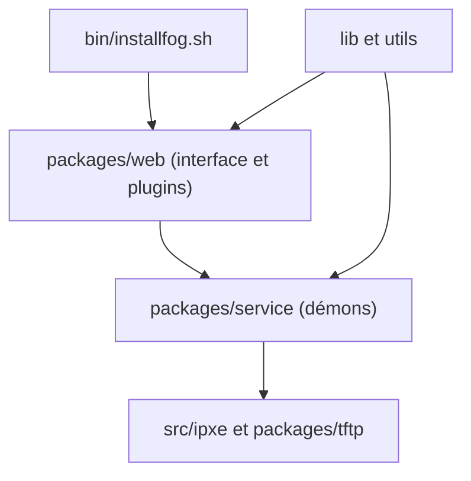

# FOGProject/fogproject

> Open suite for network-based cloning and imaging of workstations, with a web interface, for system administrators.

## The problem
Deploying or backing up the disk image of dozens of Windows PCs by hand is slow.

## What it actually does
A Linux server boots workstations over PXE/iPXE, captures or deploys images with PartClone and drives everything from a web interface. On top of that come inventory, task scheduling, memory and disk testing, wiping, and remote software installation. Service daemons handle replication and multicast, and plugins extend the interface.

## How it is wired


## Trying it
```bash
wget https://github.com/FOGProject/fogproject/archive/stable.zip; unzip stable.zip
sudo -i
cd /path/to/fogproject-stable/bin
./installfog.sh
```

## Cost and gotchas
Free. Installation as root on a Linux distribution, on a network where PXE is allowed. GPL-3.0 license.

## What it is not
Not a container or ML deployment tool: it restores PC disks. The `stable`, `dev-branch` and `working-*` branches must be carefully distinguished.

## Alternatives
- No alternative named in the README.

## For you
Ignore: an IT fleet tool, unrelated to data or AI.
