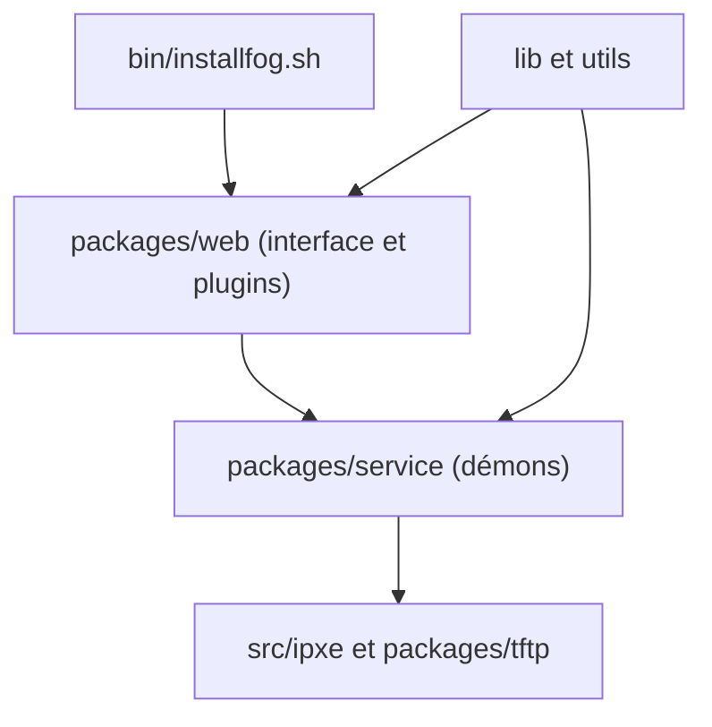

# FOGProject/fogproject

> Suite libre de clonage et d'imagerie de postes par le réseau, avec interface web, pour administrateurs systèmes.

## Le problème
Déployer ou sauvegarder l'image disque de dizaines de PC Windows à la main est long.

## Ce que ça fait vraiment
Un serveur Linux démarre les postes en PXE/iPXE, capture ou déploie des images avec PartClone et pilote le tout depuis une interface web. S'y ajoutent inventaire, planification de tâches, test mémoire et disque, effacement, installation de logiciels à distance. Des démons de service gèrent réplication et multicast, et des plugins étendent l'interface.

## Comment c'est branché


## Essayer
```bash
wget https://github.com/FOGProject/fogproject/archive/stable.zip; unzip stable.zip
sudo -i
cd /path/to/fogproject-stable/bin
./installfog.sh
```

## Coût et pièges
Gratuit. Installation en root sur une distribution Linux, avec un réseau où le PXE est autorisé. Licence GPL-3.0.

## Ce que ce n'est pas
Pas un outil de déploiement de conteneurs ou de ML : il restaure des disques de PC. Branches `stable`, `dev-branch` et `working-*` à bien distinguer.

## Alternatives
- Aucune alternative nommée dans le README.

## Pour toi
À ignorer : outil de parc informatique, sans rapport avec les données ou l'IA.

