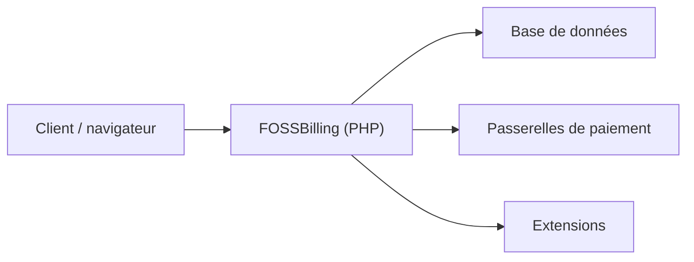

# FOSSBilling/FOSSBilling

> Free billing and client management system for hosting providers and online services.

## The problem
An online service provider needs billing, reminders and client management, without paying for a proprietary platform.

## What it actually does
PHP web application: automatic invoices and reminders, basic reports, client records, several payment gateways, a community-translated interface and extensions for integrations. It targets web hosts, but also software licenses, downloads and subscriptions.

## How it is wired
Simplified diagram based on the sheet, no diagram provided.



## Trying it
```bash
# Aucune commande dans le README :
# suivre le guide Getting Started du site de documentation
# ou essayer la démo publique
```

## Cost and gotchas
Free. You need a LAMP or LEMP stack, with the PHP ZIP extension enabled before installing or updating. Payment gateways have their own fees.

## What it is not
The project declares itself beta, with "rough edges" and limited support. It is not a data tool: details on PHP and database versions are on the website, not in the README.

## Alternatives
No alternative cited in the README.

## For you
Ignore: billing software unrelated to data, AI or MLOps, and still in beta.
