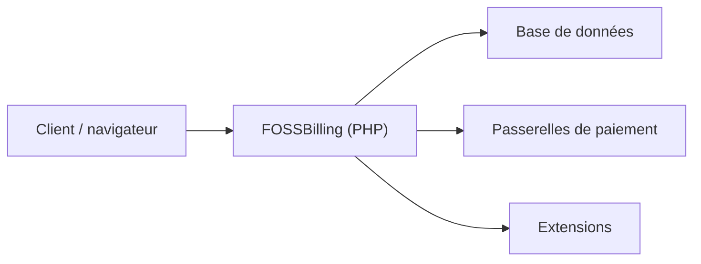

# FOSSBilling/FOSSBilling

> Système libre de facturation et de gestion de clients pour hébergeurs et services en ligne.

## Le problème
Un prestataire de services en ligne a besoin de facturation, de relances et de gestion client, sans payer une plateforme propriétaire.

## Ce que ça fait vraiment
Application web en PHP : factures automatiques et relances, rapports de base, fichier clients, plusieurs passerelles de paiement, interface traduite par la communauté et extensions pour intégrations. Elle vise les hébergeurs web, mais aussi les licences logicielles, les téléchargements et les abonnements.

## Comment c'est branché
Schéma simplifié d'après la fiche, sans diagramme fourni.



## Essayer
```bash
# Aucune commande dans le README :
# suivre le guide Getting Started du site de documentation
# ou essayer la démo publique
```

## Coût et pièges
Gratuit. Il faut une pile LAMP ou LEMP, avec l'extension PHP ZIP activée avant l'installation ou la mise à jour. Les passerelles de paiement ont leurs propres frais.

## Ce que ce n'est pas
Le projet se déclare en bêta, avec « rough edges » et support limité. Ce n'est pas un outil de données : les détails de versions PHP et de base sont sur le site, pas dans le README.

## Alternatives
Aucune alternative citée dans le README.

## Pour toi
À ignorer : logiciel de facturation sans lien avec la donnée, l'IA ou le MLOps, et encore en bêta.

