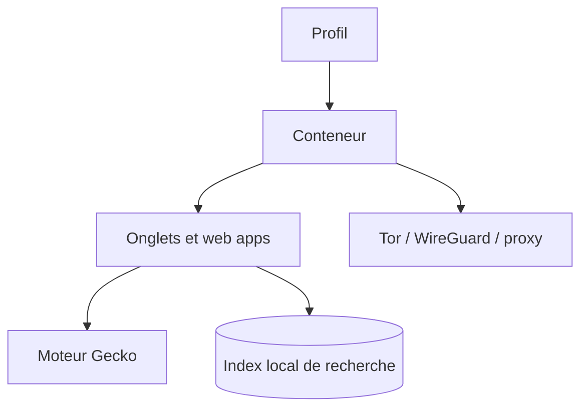

# FaFre/WebLibre

> Android browser on the Gecko engine with profiles, containers, Tor, WireGuard VPN and local search.

## The problem
Separating accounts and activities in a mobile browser, with Tor or a VPN per space, is difficult and scattered across tools.

## What it actually does
Gecko-based browser with isolated tabs, containers and separate profiles. It integrates Tor, WireGuard and proxies applied per container. It locally indexes the text of visited pages and RSS feeds for searching from the address bar. It installs sites as apps, accepts Firefox extensions, and enables strict protection, encrypted DNS and HTTPS-only by default. No telemetry of its own.

## How it is wired
Simplified diagram based on the sheet, no diagram provided.



## Trying it
```bash
apksigner verify --print-certs path/to/weblibre.apk
# Installation : GitHub Releases, Google Play ou F-Droid (voir docs.weblibre.eu)
```

## Cost and gotchas
Free; Android 8 minimum. Switching from F-Droid to GitHub or Google Play requires uninstalling, which erases all profiles.

## What it is not
Not a desktop browser. The README says "Early Access": features and settings may change. AGPL-3.0 license.

## Alternatives
No alternative named in the README.

## For you
Ignore: privacy-focused mobile browser, unrelated to data, AI or MLOps work, and still in early access.
