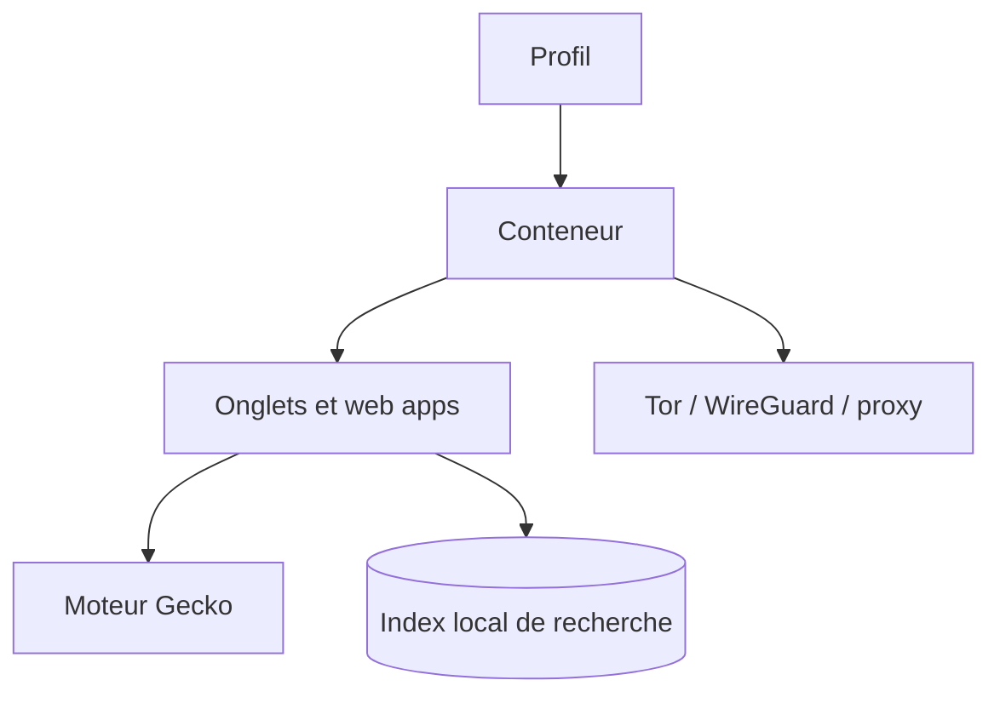

# FaFre/WebLibre

> Navigateur Android sur moteur Gecko avec profils, conteneurs, Tor, VPN WireGuard et recherche locale.

## Le problème
Séparer comptes et activités dans un navigateur mobile, avec Tor ou VPN par espace, est difficile et dispersé.

## Ce que ça fait vraiment
Navigateur basé sur Gecko avec onglets isolés, conteneurs et profils séparés. Il intègre Tor, WireGuard et proxys appliqués par conteneur. Il indexe localement le texte des pages visitées et les flux RSS pour la recherche depuis la barre d'adresse. Il installe des sites comme applications, accepte les extensions Firefox et active par défaut protection stricte, DNS chiffré et HTTPS seul. Aucune télémétrie propre.

## Comment c'est branché
Schéma simplifié d'après la fiche, sans diagramme fourni.



## Essayer
```bash
apksigner verify --print-certs path/to/weblibre.apk
# Installation : GitHub Releases, Google Play ou F-Droid (voir docs.weblibre.eu)
```

## Coût et pièges
Gratuit ; Android 8 minimum. Passer de F-Droid à GitHub ou Google Play oblige à désinstaller, ce qui efface tous les profils.

## Ce que ce n'est pas
Pas un navigateur de bureau. Le README indique « Early Access » : fonctions et réglages peuvent changer. Licence AGPL-3.0.

## Alternatives
Aucune alternative nommée dans le README.

## Pour toi
À ignorer : navigateur mobile axé vie privée, sans lien avec un travail data, IA ou MLOps, et encore en accès anticipé.

