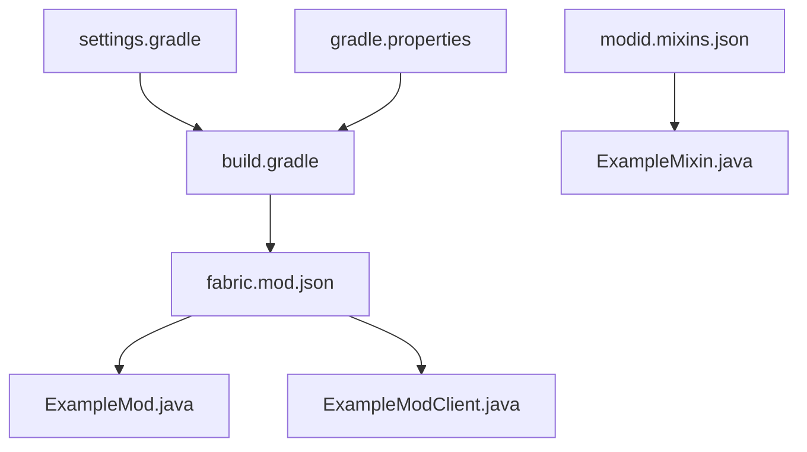

# FabricMC/fabric-example-mod

> Gradle project template for creating a Minecraft mod with the Fabric loader.

## The problem
Starting a Minecraft mod means setting up the build structure, the entry points and the mixins.

## What it actually does
The repository provides a ready-to-copy Gradle project. fabric.mod.json declares two entry points, ExampleMod (common) and ExampleModClient (client). The files modid.mixins.json and modid.client.mixins.json reference the mixins that modify the game code. The README is reduced to a pointer to the Fabric documentation.

## How it is wired

## Trying it
No command is documented: the README points to the Fabric documentation page for the IDE you use.

## Cost and gotchas
Free (CC0-1.0). The real requirement is a Java JDK and Gradle, which are missing from the list. A mod is worth nothing without Minecraft.

## What it is not
It is not a finished mod or a library: it is a template to rename. It is not a general-purpose tool.

## Alternatives
No alternative named in the README.

## For you
Ignore: only a Minecraft mod project justifies it, which falls outside the data, AI and MLOps scope.
