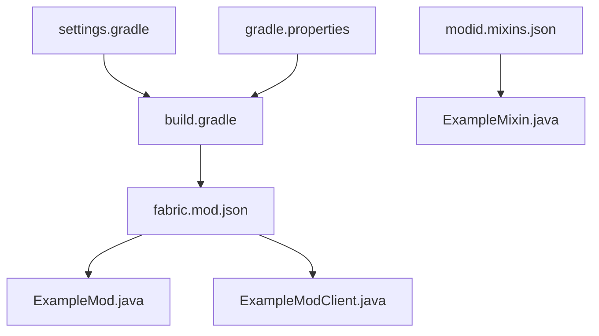

# FabricMC/fabric-example-mod

> Modèle de projet Gradle pour créer un mod Minecraft avec le chargeur Fabric.

## Le problème
Démarrer un mod Minecraft demande de monter la structure de build, les points d'entrée et les mixins.

## Ce que ça fait vraiment
Le dépôt fournit un projet Gradle prêt à copier. fabric.mod.json déclare deux points d'entrée, ExampleMod (commun) et ExampleModClient (client). Les fichiers modid.mixins.json et modid.client.mixins.json référencent les mixins qui modifient le code du jeu. Le README est réduit à un renvoi vers la documentation Fabric.

## Comment c'est branché

## Essayer
Aucune commande documentée : le README renvoie à la page de documentation Fabric de l'IDE utilisé.

## Coût et pièges
Gratuit (CC0-1.0). Le besoin réel est un JDK Java et Gradle, absents de la liste. Un mod ne vaut rien sans Minecraft.

## Ce que ce n'est pas
Ce n'est pas un mod fini ni une bibliothèque : c'est un gabarit à renommer. Ce n'est pas un outil généraliste.

## Alternatives
Aucune alternative nommée dans le README.

## Pour toi
À ignorer : seul un projet de mod Minecraft le justifie, ce qui sort du périmètre data, IA et MLOps.

