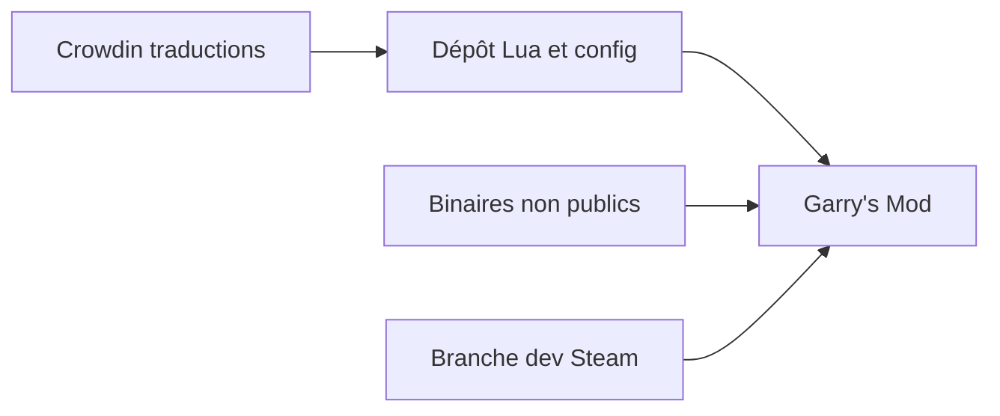

# Facepunch/garrysmod

> Lua extensions, text and configuration of the game Garry's Mod, by the publisher Facepunch.

## The problem
The game's contributors need a public place to propose fixes to the Lua scripts and configuration files.

## What it actually does
The repository contains the game's Lua extensions, texts and configurations. The binary sources are not public and derive from the Source SDK. The README points to Discord, the Steam development branch, the bug and request trackers, and Crowdin for translations.

## How it is wired
Simplified diagram based on the sheet, no diagram provided.

## Trying it
No command documented in the README. Changes are tested through the game's development branch on Steam.

## Cost and gotchas
The game is a commercial product on Steam (the price is not in the README). No license is declared in the catalog.

## What it is not
Not the complete game: the binaries are not public. Not a tool reusable outside this game.

## Alternatives
No alternative named in the README.

## For you
Ignore: video game code unrelated to data, AI or MLOps, and with no clear license to reuse it.
