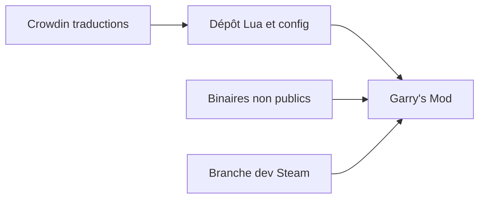

# Facepunch/garrysmod

> Extensions Lua, texte et configuration du jeu Garry's Mod, éditeur Facepunch.

## Le problème
Les contributeurs du jeu ont besoin d'un endroit public pour proposer des correctifs aux scripts Lua et aux fichiers de configuration.

## Ce que ça fait vraiment
Le dépôt contient les extensions Lua, textes et configurations du jeu. Les sources binaires ne sont pas publiques et dérivent du Source SDK. Le README renvoie vers Discord, la branche de développement Steam, les trackers de bugs et de demandes, et Crowdin pour les traductions.

## Comment c'est branché
Schéma simplifié d'après la fiche, sans diagramme fourni.

## Essayer
Aucune commande documentée dans le README. Les changements se testent via la branche de développement du jeu sur Steam.

## Coût et pièges
Le jeu est un produit commercial sur Steam (le prix n'est pas dans le README). Aucune licence n'est déclarée dans le catalogue.

## Ce que ce n'est pas
Pas le jeu complet : les binaires ne sont pas publics. Pas un outil réutilisable hors de ce jeu.

## Alternatives
Aucune alternative nommée dans le README.

## Pour toi
À ignorer : code de jeu vidéo sans rapport avec la data, l'IA ou le MLOps, et sans licence claire pour le réutiliser.

