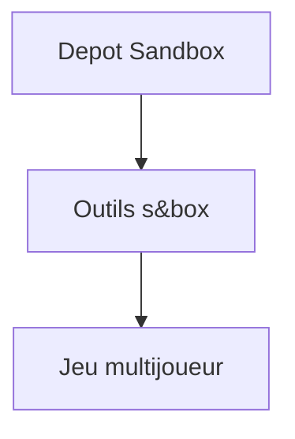

# Facepunch/sandbox

> Multiplayer sandbox game from Facepunch built with the s&box tools.

## The problem
Undocumented: the README describes no need.

## What it actually does
A multiplayer sandbox-type game mode for s&box, with a demo video. The README says nothing more: how it works, installation and content are not documented.

## How it is wired
Simplified diagram based on the fiche, no diagram provided.

## Trying it
No command documented.

## Cost and gotchas
Free (MIT). The s&box engine is required, not detailed in the README. Pull requests must follow the same code style and may be rejected.

## What it is not
Not a tool or a library. The README does not say how to run it.

## Alternatives
No alternative named in the README.

## For you
Ignore: a video game unrelated to data or AI, and a README with no content.
