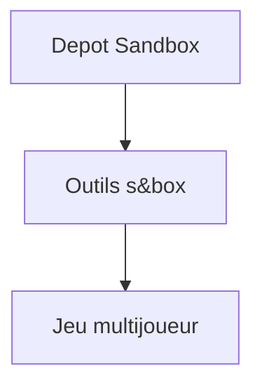

# Facepunch/sandbox

> Jeu bac à sable multijoueur de Facepunch construit avec les outils de s&box.

## Le problème
Non documenté : le README ne décrit aucun besoin.

## Ce que ça fait vraiment
Un mode de jeu multijoueur de type sandbox pour s&box, avec une vidéo de démonstration. Le README ne dit rien de plus : fonctionnement, installation et contenu ne sont pas documentés.

## Comment c'est branché
Schéma simplifié d'après la fiche, sans diagramme fourni.

## Essayer
Aucune commande documentée.

## Coût et pièges
Gratuit (MIT). Le moteur s&box est nécessaire, non détaillé dans le README. Les pull requests exigent le même style de code et peuvent être refusées.

## Ce que ce n'est pas
Pas un outil ni une bibliothèque. Le README ne permet pas de savoir comment le lancer.

## Alternatives
Aucune alternative nommée dans le README.

## Pour toi
À ignorer : jeu vidéo sans lien avec la data ou l'IA, et un README sans contenu.

