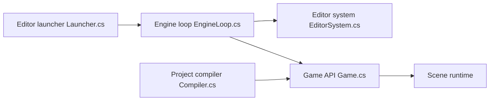

# Facepunch/sbox-public

> Sources of the s&box game engine (Source 2 and .NET), for contributors who build the engine.

## The problem
Contributing to a game engine requires access to its code, editor and build tools.

## What it actually does
Repository of the C# engine, the editor, the tools and the content. The native Source 2 core is downloaded as precompiled binaries by `Setup`, with no C++ toolchain. The editor is otherwise installed from Steam. A git hook fetches new binaries on each pull.

## How it is wired


## Trying it
```bash
git clone https://github.com/Facepunch/sbox-public.git
cd sbox-public
./Setup.sh
```

## Cost and gotchas
Free. .NET 10 SDK required; Intel Mac not supported; native binaries downloaded. License not identified by GitHub: read it before reuse. 2,570 open issues.

## What it is not
Not the guide to creating games: the README points to the website documentation for that.

## Alternatives
No alternative named in the README.

## For you
To ignore: game engine unrelated to data or AI, under a license to check.
