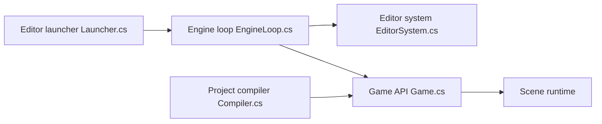

# Facepunch/sbox-public

> Sources du moteur de jeu s&box (Source 2 et .NET), pour contributeurs qui compilent le moteur.

## Le problème
Contribuer à un moteur de jeu exige d'accéder à son code, à l'éditeur et aux outils de compilation.

## Ce que ça fait vraiment
Dépôt du moteur C#, de l'éditeur, des outils et du contenu. Le cœur natif Source 2 est téléchargé sous forme de binaires précompilés par `Setup`, sans toolchain C++. L'éditeur s'installe sinon depuis Steam. Un hook git récupère les nouveaux binaires à chaque pull.

## Comment c'est branché


## Essayer
```bash
git clone https://github.com/Facepunch/sbox-public.git
cd sbox-public
./Setup.sh
```

## Coût et pièges
Gratuit. SDK .NET 10 requis ; Intel Mac non pris en charge ; binaires natifs téléchargés. Licence non identifiée par GitHub : à lire avant réutilisation. 2 570 issues ouvertes.

## Ce que ce n'est pas
Pas le guide pour créer des jeux : le README renvoie vers la documentation du site pour cela.

## Alternatives
Aucune alternative nommée dans le README.

## Pour toi
À ignorer : moteur de jeu sans rapport avec la data ou l'IA, sous licence à vérifier.

