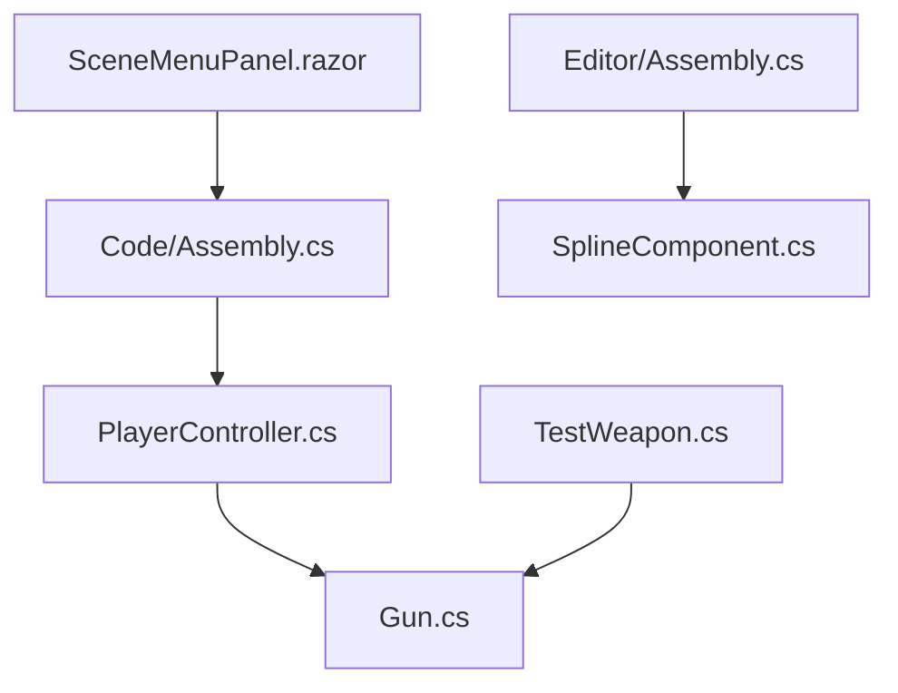

# Facepunch/sbox-scenestaging

> s&box project serving as a testing ground for the future Scene/GameObject/Component system.

## The problem
Facepunch wants to iterate quickly on a scene system before integrating it into the s&box engine.

## What it actually does
Example C# components (PlayerController, Gun, GameNetworkManager), Razor panels, libraries (splines, weaponlab) and editor tools. The plan includes prefabs, networking and Hammer integration.

## How it is wired


## Trying it
```bash
# Pas de commande : télécharger le dépôt, l'ajouter comme projet dans s&box,
# ouvrir Hierarchy et Scene, ouvrir une scène, lancer.
```

## Cost and gotchas
Free. Requires s&box. No license declared.

## What it is not
Not a finished game or a stable API: a staging area.

## Alternatives
No alternative named in the README.

## For you
Ignore: game engine development, unrelated to data/AI.
