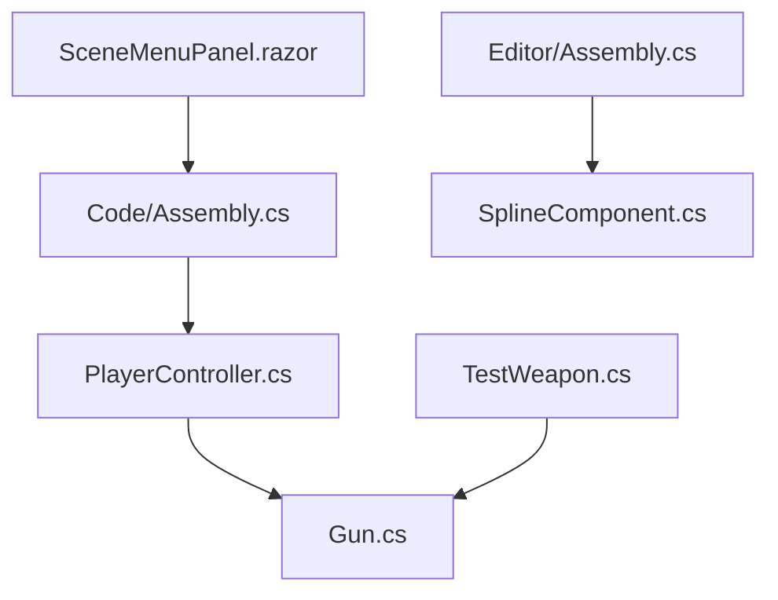

# Facepunch/sbox-scenestaging

> Projet s&box servant de terrain d'essai au futur système Scene/GameObject/Component.

## Le problème
Facepunch veut itérer vite sur un système de scènes avant de l'intégrer au moteur s&box.

## Ce que ça fait vraiment
Composants C# d'exemple (PlayerController, Gun, GameNetworkManager), panneaux Razor, librairies (splines, weaponlab) et outils d'éditeur. Le plan prévoit prefabs, réseau et intégration à Hammer.

## Comment c'est branché


## Essayer
```bash
# Pas de commande : télécharger le dépôt, l'ajouter comme projet dans s&box,
# ouvrir Hierarchy et Scene, ouvrir une scène, lancer.
```

## Coût et pièges
Gratuit. Nécessite s&box. Aucune licence déclarée.

## Ce que ce n'est pas
Pas un jeu fini ni une API stable : zone de transit.

## Alternatives
Aucune alternative nommée dans le README.

## Pour toi
À ignorer : développement de moteur de jeu, sans lien avec data/IA.

