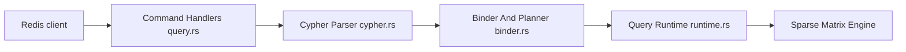

# FalkorDB/FalkorDB

> Graph database packaged as a Redis module, targeting agent memory and LLM knowledge graphs.

## The problem
Agents and RAG applications need a low-latency knowledge graph that can be queried in Cypher.

## What it actually does
Redis module in Rust: graphs stored as sparse matrices (GraphBLAS), OpenCypher queries executed through linear algebra, indexes, JavaScript UDF libraries. Multi-tenant. Official clients for Python, Node, Java, Rust, Go, C#.

## How it is wired


## Trying it
```bash
docker run -p 6379:6379 -p 3000:3000 -it --rm -v ./data:/var/lib/falkordb/data falkordb/falkordb
redis-cli
```

## Cost and gotchas
Free to try. Building from source is heavy (GraphBLAS, LAGraph, RediSearch, OpenMP, clang). The license is "unidentified": read it before commercial use.

## What it is not
Not a general vector database; the README talks about graphs. The announced performance comes from the authors. 941 open issues.

## Alternatives
No alternative named in the README.

## For you
Worth adopting as a trial: a direct fit for agent memory and GraphRAG, with a one-command Docker start; check the license first.
