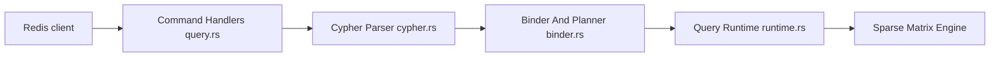

# FalkorDB/FalkorDB

> Base de données de graphes sous forme de module Redis, ciblant mémoire d'agents et graphes de connaissance LLM.

## Le problème
Les agents et applications RAG ont besoin d'un graphe de connaissance à faible latence, interrogeable en Cypher.

## Ce que ça fait vraiment
Module Redis en Rust : stockage des graphes en matrices creuses (GraphBLAS), requêtes OpenCypher exécutées par algèbre linéaire, index, bibliothèques UDF en JavaScript. Multi-locataire. Clients officiels pour Python, Node, Java, Rust, Go, C#.

## Comment c'est branché


## Essayer
```bash
docker run -p 6379:6379 -p 3000:3000 -it --rm -v ./data:/var/lib/falkordb/data falkordb/falkordb
redis-cli
```

## Coût et pièges
Gratuit à l'essai. Compiler depuis les sources est lourd (GraphBLAS, LAGraph, RediSearch, OpenMP, clang). La licence est « non identifiée » : à lire avant usage commercial.

## Ce que ce n'est pas
Pas une base vectorielle générale ; le README parle de graphes. Les performances annoncées viennent des auteurs. 941 issues ouvertes.

## Alternatives
Aucune alternative nommée dans le README.

## Pour toi
À adopter à l'essai : cadre direct pour la mémoire d'agents et le GraphRAG, avec démarrage en une commande Docker ; vérifie d'abord la licence.

