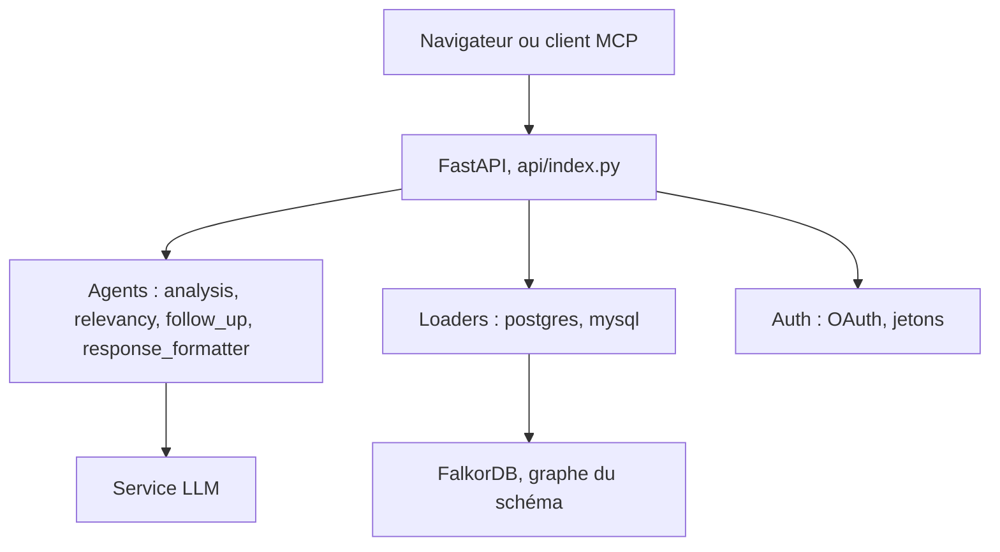

# FalkorDB/QueryWeaver

> Text2SQL tool that turns plain-language questions into SQL using a schema graph.

## The problem
Querying a relational database requires writing SQL, and language models quickly go wrong on a schema they don't know.

## What it actually does
Loads the schema of a PostgreSQL or MySQL database into FalkorDB as a graph. A chain of LLM agents analyzes the question, filters for relevance, asks follow-up questions and formats the answer. It returns SQL and results through a web interface, REST API, MCP server or Python SDK. Destructive queries ask for confirmation.

## How it is wired


## Trying it
```bash
docker run -p 5000:5000 -it falkordb/queryweaver
cp .env.example .env
docker run -p 5000:5000 --env-file .env falkordb/queryweaver
pip install queryweaver
```

## Cost and gotchas
An LLM API key is required (OpenAI, Gemini, Anthropic, Cohere, Azure or Ollama) and so is a FalkorDB instance. With Anthropic, a Voyage key or an embedding model is also needed, otherwise startup fails.

## What it is not
Not a full BI tool. It only supports PostgreSQL and MySQL, and the AGPL license weighs on use as a service.

## Alternatives
No alternative named in the README.

## For you
Worth watching: the schema-graph approach is useful for enterprise Text2SQL, but the AGPL and the dependency on FalkorDB call for a test before adoption.
