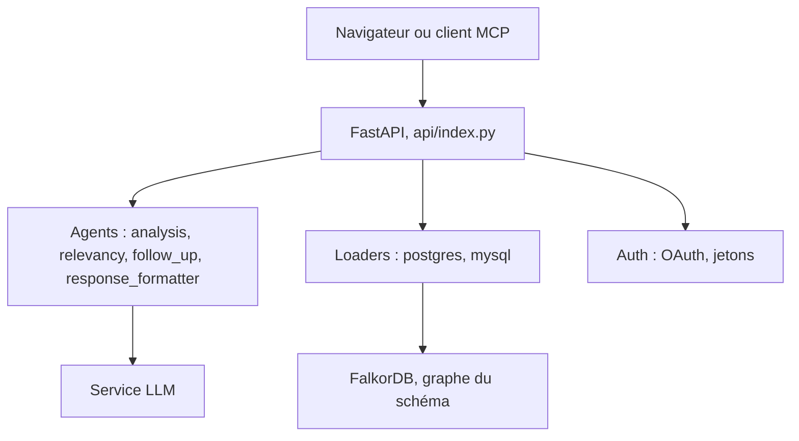

# FalkorDB/QueryWeaver

> Outil Text2SQL qui transforme des questions en français courant en SQL grâce à un graphe du schéma.

## Le problème
Interroger une base relationnelle exige d'écrire du SQL, et les modèles de langage se trompent vite sur un schéma qu'ils ne connaissent pas.

## Ce que ça fait vraiment
Charge le schéma d'une base PostgreSQL ou MySQL dans FalkorDB sous forme de graphe. Une chaîne d'agents LLM analyse la question, filtre la pertinence, pose des questions de suivi et formate la réponse. Elle renvoie SQL et résultats via interface web, API REST, serveur MCP ou SDK Python. Les requêtes destructrices demandent une confirmation.

## Comment c'est branché


## Essayer
```bash
docker run -p 5000:5000 -it falkordb/queryweaver
cp .env.example .env
docker run -p 5000:5000 --env-file .env falkordb/queryweaver
pip install queryweaver
```

## Coût et pièges
Une clé d'API LLM est nécessaire (OpenAI, Gemini, Anthropic, Cohere, Azure ou Ollama) et une instance FalkorDB aussi. Avec Anthropic, il faut en plus une clé Voyage ou un modèle d'embedding, sinon le démarrage échoue.

## Ce que ce n'est pas
Pas un outil de BI complet. Il ne gère que PostgreSQL et MySQL, et la licence AGPL pèse sur un usage en service.

## Alternatives
Aucune alternative nommée dans le README.

## Pour toi
À surveiller : l'approche graphe du schéma est utile pour du Text2SQL en entreprise, mais l'AGPL et la dépendance à FalkorDB demandent un test avant adoption.

