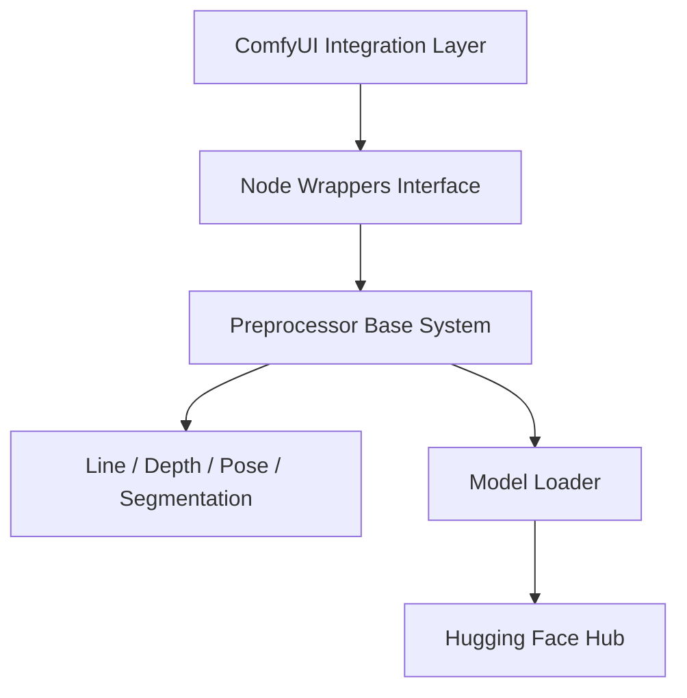

# Fannovel16/comfyui_controlnet_aux

> Set of ComfyUI nodes that produces the guide images (edges, depth, pose) for ControlNet.

## The problem
ControlNet requires conditioning images (edges, depth maps, skeletons) that would otherwise be made with disparate tools.

## What it actually does
Bundles lllyasviel's annotators as ComfyUI nodes: lines (Canny, HED, Lineart...), depth and normals (MiDaS, Depth Anything, Zoe...), poses (OpenPose, DWPose, animals), segmentation (OneFormer, UniFormer, SAM), recoloring. An "AIO Aux Preprocessor" node gathers them. Weights are fetched from the Hugging Face Hub.

## How it is wired


## Trying it
```bash
cd /ComfyUI/custom_nodes/
git clone https://github.com/Fannovel16/comfyui_controlnet_aux/
cd comfyui_controlnet_aux
pip install -r requirements.txt
```

## Cost and gotchas
DWPose/AnimalPose run on CPU by default; acceleration goes through TorchScript or ONNXRuntime (CUDA 11.8 for NVidia unless compiled). Many weights are downloaded on first use.

## What it is not
Only makes guide images, no generation or inpainting outside a dedicated node. The code is copied from lllyasviel's annotators.

## Alternatives
- ComfyUI Manager: recommended installation method.
- sd-webui-controlnet: WebUI equivalent, mapped in the README tables.

## For you
Adopt it if you do ControlNet-driven image generation in ComfyUI: the preprocessor catalog is complete; keep an eye on the single maintainer.
