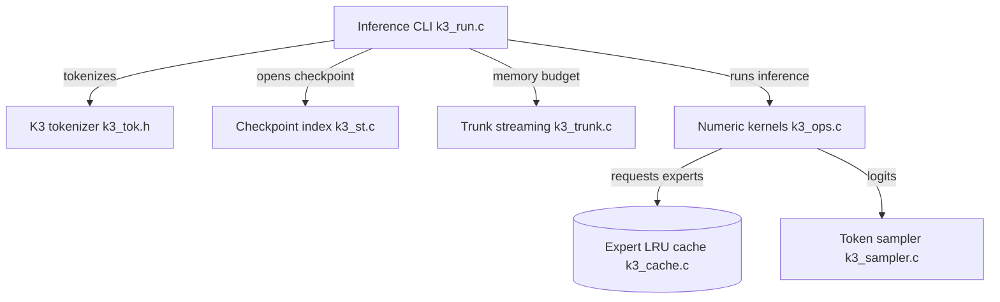

# FareedKhan-dev/kimi-k3-in-c

> CPU inference engine in C that runs Kimi K3 (2.78 T parameters) without a GPU, from 8 GB of RAM.

## The problem
A 1.56 TB model fits in the memory of no ordinary machine, and the usual engines assume GPUs or clusters.

## What it actually does
- Reads the safetensors checkpoint, streams the dense trunk (93 layers) from disk and never loads the experts in full: products are computed directly from their 4-bit form.
- An expert LRU cache and presets (`ultra` to `max`) tune memory use; the output is identical, only the time changes.
- Announced measurements: 26.5 s per token with 8 GB, 5.6 s with 128 GB or more.
- XTML chat mode, tokenizer and kernels written in C.

## How it is wired


## Trying it
```bash
git clone https://github.com/FareedKhan-dev/kimi-k3-in-c.git
cd kimi-k3-in-c
make -j
make test
./scripts/download-model.sh ~/k3model
./scripts/pack-trunk.sh ~/k3model ~/k3trunk
```

## Cost and gotchas
About 1.7 TB of free disk, preferably local NVMe; a 1.56 TB download with a Hugging Face token. A slow or networked disk slows things down heavily.

## What it is not
Not an interactive service: several seconds per token, even on a powerful machine. The `make test` test does not use the real model. Does not replace vLLM or llama.cpp in production.

## Alternatives
The README names no alternative (the end of the README is truncated).

## For you
Worth watching: a remarkable demonstration of memory streaming for understanding MoE inference, not a working tool given the speed and storage required.
