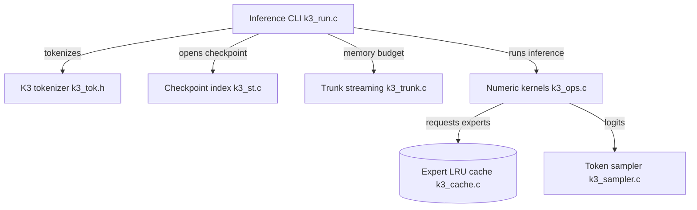

# FareedKhan-dev/kimi-k3-in-c

> Moteur d'inférence CPU en C qui fait tourner Kimi K3 (2,78 T de paramètres) sans GPU, dès 8 Go de RAM.

## Le problème
Un modèle de 1,56 To ne tient dans la mémoire d'aucune machine ordinaire, et les moteurs usuels supposent des GPU ou des clusters.

## Ce que ça fait vraiment
- Lit le checkpoint safetensors, garde le tronc dense (93 couches) en flux disque et ne charge jamais les experts en entier : produits directement depuis leur forme 4 bits.
- Un cache LRU d'experts et des préréglages (`ultra` à `max`) règlent la mémoire ; la sortie est identique, seul le temps change.
- Mesures annoncées : 26,5 s par token avec 8 Go, 5,6 s avec 128 Go ou plus.
- Mode chat XTML, tokenizer et noyaux écrits en C.

## Comment c'est branché


## Essayer
```bash
git clone https://github.com/FareedKhan-dev/kimi-k3-in-c.git
cd kimi-k3-in-c
make -j
make test
./scripts/download-model.sh ~/k3model
./scripts/pack-trunk.sh ~/k3model ~/k3trunk
```

## Coût et pièges
Environ 1,7 To de disque libre, de préférence NVMe local ; téléchargement de 1,56 To avec un jeton Hugging Face. Un disque lent ou réseau ralentit fortement.

## Ce que ce n'est pas
Pas un service interactif : plusieurs secondes par token, même sur machine puissante. Le test `make test` n'utilise pas le vrai modèle. Ne remplace pas vLLM ou llama.cpp en production.

## Alternatives
Le README ne nomme aucune alternative (la fin du README est tronquée).

## Pour toi
À surveiller : démonstration remarquable de streaming mémoire pour comprendre l'inférence MoE, pas un outil de travail vu la vitesse et le stockage requis.

